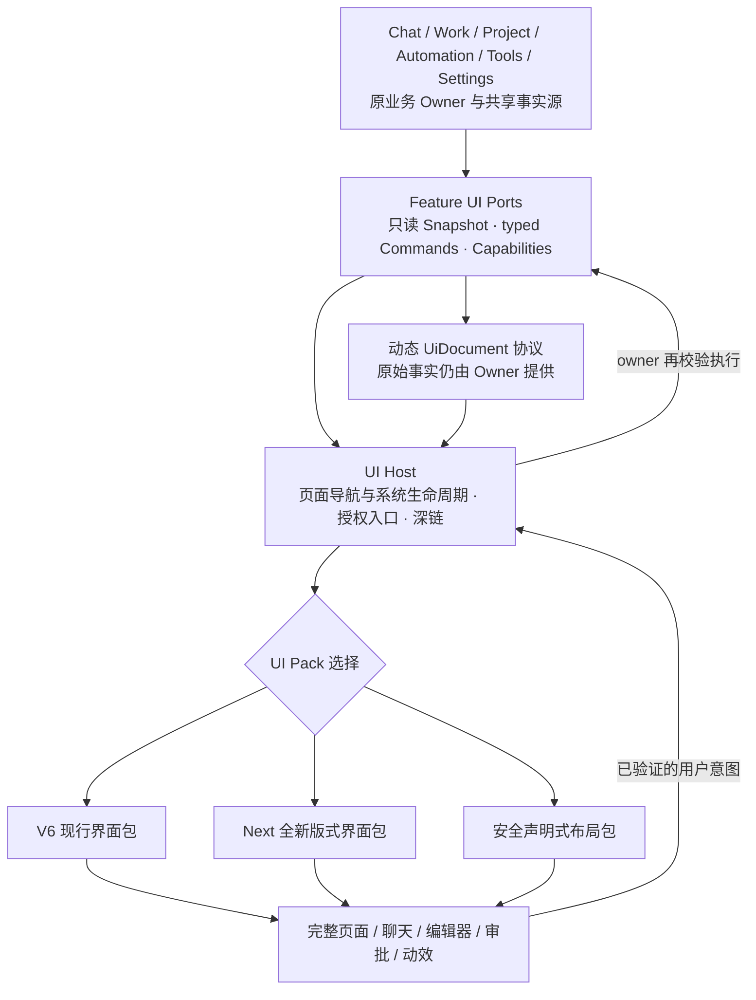

# 777 UI v3.0-R4 · 可插拔界面底座与存量问题治理完整实施方案

> **方案定位：** 在 v2.2-R2 核实基础上做架构层级升级，**以本文件第 0–13 章为当前实施决策；第 13 章定义已核实问题的处理顺序与回归门槛**；所附 v2.2-R2 全文仅作已核实问题和原技术路线的历史底稿，出现冲突以 v3.0 为准。
>
> **R3 起草核查基线：** `sy220284/777` `main @ 3b243ec966b147d09f5210011092af5a3329b73e`（2026-10-13）；**R4 最新复核基线见第 13.1 节**。已核对 `ARCHITECTURE.md`、`LocalFeatureCatalog.kt`、`LocalFeaturePageContent.kt`、`LocalShellUiContribution.kt`、`LocalHarnessScreen.kt`、`LocalConversationSurface.kt`、`LocalConversationComposer.kt`、`LocalFeatureUiActions.kt` 和相关状态/时间线/设计组件；这是静态设计审查，非新功能实现或设备验收。
>
> **交付边界：** 本文件修订并保存到用户资料库。**没有修改 GitHub 生产代码、没有提交 PR、没有运行新架构的编译或真机验证。**

## 0. 结论与目标：把“再次换整套 UI”从项目改造变成换一个 UI 包

777 现有的 `LocalFeatureCatalog` 解决的是“哪个 Feature 拥有什么路由”；v2.2-R2 解决的是“AI 如何生成受控的动态交互卡”。**这两项都不等于整套 UI 可插拔**：现有 `LocalFeatureUiContribution` 直接携带 `@Composable (LocalFeaturePage) -> Unit`，`LocalHarnessScreen` 构建数十个 UI 业务回调、直接装配各 Feature 的 Compose 页面；`LocalConversationSurface`/`LocalConversationComposer` 也分别含大量交互与 V6 绘制细节。

**新目标**：把真实功能与 UI 画法之间建立稳定的双向插口：

- **业务插座**：只负责提供状态、可执行能力、合法操作与回执；状态仍归 Chat/Work/Automation/Tools/Media/Project/Settings 等实际 Owner。
- **界面插头（UI Pack）**：独立提供整套导航、页面结构、组件、材质、动效、图标、展示方式；不读取 Feature 内部 Store/Runtime。
- **宿主（UI Host）**：统一管理屏幕生命周期、系统返回、输入法、文件选择器、权限入口、无障碍、通知深链与错误兜底；不替业务执行操作。

**成功的证明**：明天做一个风格与 V6 完全不同的 UI 时，只需实现新的 UI Pack 与其注册/资产，不要求逐页修改 Feature Owner、消息运行时、媒体存储或工具执行。不是“换皮肤”：页面层级、导航、动效、聊天消息排版与控件都能改。

## 1. 代码现状：哪些已经有，哪些正挡住“换插头”

| 当前代码事实 | 可复用基础 | 必须补的断层 |
|---|---|---|
| `LocalFeatureCatalog`：7 个产品模块、9 条顶级路由，启动期归属唯一 | **保留**原路由所有权和 Feature 组合机制 | 9 路由只是一级页面，不覆盖二级页、弹层、会话特殊状态；需要可机读 Scene/Capability 清单 |
| `LocalFeatureUiContribution` 包含 `content: @Composable (...) -> Unit`、返回、抽屉、恢复回调 | 已有页面注册思路和严格归属 | **拆成 Feature 业务提供方与 UI Pack 页面实现方**；业务不再提供具体样式页面 |
| `LocalHarnessScreen.kt` 约 1149 行、直接组合 `viewModel`、`LocalShellFeatureUiActions` 和各页面贡献 | 现有功能入口与导航时序可复用 | 从中移走具体页面样式/特有回调组装，保留极薄 UI Host；必要的合法业务端口从统一边界取得 |
| `LocalConversationSurface.kt` 约 1772 行、`LocalConversationComposer.kt` 约 561 行 | 消息、附件、编辑、分支、队列、输入机制完整 | 时间线、编辑器、模型选择、工具审批等各自变成语义 Scene 与独立 UI 插槽，不让新包复制旧业务判断 |
| `LocalConversationSurfaceState` 目前含角色/Work 模型及一些 UI 特有字段 | Chat/Work 窄投影已有基础 | 再提供**不依赖 Compose、不向 UI 暴露领域可写对象**的稳定只读 Scene Snapshot；Chat/Work 隔离继续成立 |
| V6 `LocalSyColors`、`SyMetric`、`SyMotion` 和 `Sy*` 组件 | **继续作为 V6 UI Pack 的内部设计系统** | 不再把 V6 组件名、颜色、Material 层级当成所有未来 UI 的硬依赖 |
| 已有 EventLog、媒体 Store、Automation scheduler、Schema 校验器 | 真实进度、成果、费用、权限不需要重造 | 统一绑定显示快照与业务动作，不把 UI Pack 变成第二 Owner |

### 根因判断

现状仍把四件事混在大块 Compose 页面：**业务事实转换、交互动作权限、系统交互、具体页面外观**。只换 `Sy*` 组件没有解决后三者之间的耦合，因此下一套 UI 仍要逐页替换。

## 2. 最优架构：双插口 + 极薄宿主 + 可替换 UI 包



### 2.1 第一种插口：Feature UI Port（**必须最先稳定**）

每个 Feature 提供独立、明确、可测试的契约，而不是一个能操作所有系统的万能 `onAction(String)`：

- **只读状态**：`ChatSceneSnapshot`、`WorkRunSceneSnapshot`、`MediaCreationSceneSnapshot`、`AutomationSceneSnapshot` 等可公开展示的稳定字段；包括 loading/error/empty/content、来源、身份代次、能力可用原因与版本。状态快照不依赖 `@Composable`、颜色/`dp`/`sp`、V6 组件或私有 Store 类型。
- **强类型用户命令**：发送/重生成、审批真实 pendingId、选择会话、运行或停止、编辑任务、提交媒体参数等分别由**所属 Feature Port**接受，返回接受、拒绝、需要审批、排队、错误、结果未知等真实回执；不让 UI 自行拼接内部工具命令。
- **能力描述**：支持哪些动作、当前哪些可用、为什么不可用、需要什么授权；UI 决定呈现按钮/菜单/卡片，但不能把“显示了按钮”等同于“可执行”。
- **实时权限与恢复**：操作提交时再次验证会话/分支/运行/账户/项目/权限的身份；跨进程幂等由 Owner 管，UI 防抖不能替代副作用治理。
- **流与任务身份**：用于显示的进度流、媒体状态和证据引用来自已有事件/Store 的有界投影；不建第二执行账本。

`LocalFeatureUiActions` 当前是 Compose 页面用的迁移回调汇合点。**目标不是把它重命名为 `UiPort`**，而是逐步把其业务含义改由稳定的 Feature 接口表达；原回调仅在迁移期间由兼容适配器承载，最终新 UI Pack 不应依赖旧回调大对象。

### 2.2 第二种插口：UI Scene / Surface 协议（**允许重做布局，不只是换肤**）

`LocalFeatureRoute` 继续是稳定顶级导航标识；另设**可版本化、可机读的 UI Scene 清单**，覆盖全部真实可见场景，不只 9 个路由：

- 顶级页：HOME、PERSONA_GALLERY、DIARY、WORKSPACE、RUN_CENTER、PROJECT、TASKS、TOOLS、SETTINGS。
- 组合式槽位：会话页头、消息时间线、Composer、回复状态、动态卡、审批、成果、媒体播放、角色/群聊入口等。
- 非页面场景：编辑弹层、账户选择、文件选择、删除确认、付费提醒、只读详情、搜索、错误/空白/加载、深链唤起和后台通知回到原现场。
- 必要语义：入口与返回链、可执行操作、输入值保留、无障碍语义、失败可恢复；**不规定**必须用 Drawer、底部五栏、玻璃卡、颜色或具体转场。

UI Pack 自行声明所实现的 `sceneId`、`slotId`、所需 `capabilities`、最低契约版本、可选功能/主题；宿主据此检验覆盖。不同 UI 可以使用完全不同的导航和版面，但依然访问同一个功能出口。

**防止“有插座却换不了”**：清单从真实 Feature 场景和用户旅程汇总；38 个 V6 设计场景是当前视觉验收参考，不是永久限制未来设计只能有 38 屏。缺失的必要 Scene 不应被旧 V6 的页面偷偷代替后宣称整包已完成。

### 2.3 UI Host：系统交互的统一底座

宿主只提供各 UI 包共用的基础设施：

1. 稳定的导航状态、返回手势/深链、会话和项目定位（路由语义稳定，导航视觉完全由 UI 包负责）；
2. 键盘/焦点、系统文件选择器、分享、Android 权限交互入口、系统栏、屏幕适配；
3. `SaveableState`、输入草稿恢复、页面切换、进程重建、网络中断/重试的 UI 状态生命周期（持久业务事实仍由 Owner 管）；
4. 日志与用户可见错误、安全提示/审批、无障碍语义接口、减少动效、系统震动适配；
5. 跨功能返回原消息/任务/媒体成果的深链和统一消息锚点；
6. 未适配 UI 包、版本不兼容或缺 Scene 时可解释地拒绝切换，继续使用稳定包，不把功能隐藏成空白页。

UI Host 不持有角色记忆、Work Todo、媒体任务、账单、审批或自动化排程事实，也不直接持有 `LocalToolExecutionCoordinator` 的执行口。

### 2.4 UI Pack：新的 UI 只实现它自己

每个 UI Pack 对外暴露一个清晰入口与清单，例如：

```text
UiPackManifest
  id / version / minContractVersion / supportedScenes / requiredCapabilities
  supportedWindowClasses / supportsDark / accessibilityCapabilities

UiPack
  visualLanguage           自己的排版、间距、材质、图标、动效
  navigationRenderer       自己的底栏、抽屉、搜索和返回呈现
  sceneRenderers           页面、弹层、对话、编辑器、设置等
  dynamicDocumentRenderer  UiDocument 在本包的原生绘制方式
  fallbackPolicy           未支持场景要明确声明，不允许静默偷换旧 UI
```

这是**契约结构示意，不是声称代码中已有这些类**。实际接口应优先用 Kotlin 强类型和可覆盖的 Compose `@Composable`，不要滥用字符串动作表或把全部场景压进一个巨型万能 UI 数据类。

## 3. “明天再换一套 UI”有三种真实可达到的替换等级

| 级别 | 用户能更换的东西 | 交付方式 | 不能夸大的边界 |
|---|---|---|---|
| **视觉包** | 色彩、材质、字号、图标、背景、标准动效参数 | 已打包资源时可直接切换 | 不能实现完全新布局/复杂交互 |
| **声明式布局包** | 已有语义 Scene 的布局组合、导航排列、控件摆放、支持的动效、部分交互流程 | 先发布可信的模板协议与本机渲染能力后，可以不改业务代码切换布局包 | 超出协议的新交互/复杂控件需要扩展渲染器，不能无限自由 |
| **完整 Compose UI Pack** | **全新信息架构、页面、组件、交互行为、动效** | 开发独立 UI Pack，并随新的 APK/AAB 一起发布；已内置多个包时可运行时切换 | Android 不能把任意未经审核的 Kotlin/Compose 源码当成安全的配置实时插入运行；新增能力仍需接口/版本适配 |

**主线推荐：完整 Compose UI Pack + 可选声明式布局包。** 后者适合快速尝试构图；前者保证“换整套 UI”不会被固定模板锁死。不采用运行时加载未知 APK/任意可执行脚本绕过 Android 安全体系。

## 4. R2 的智能交互 UI 怎么接入“插排”

R2 原拟：`UiDocument → SyDynamicDocument → Sy* 控件`。现在改为：

```text
模型生成受限 UiDocument
  → 共享 JsonSchemaValidator + 节点/动作语义校验
  → Shared Session 下合法的 UI sidecar/事件身份
  → UI Host 的 Dynamic Document Slot
  → 当前 UiPack 提供的 DynamicDocumentRenderer
  → 使用该 UI 包自己的原生组件、布局及动效
  → 按真实 Feature Port 执行经过审批/校验的命令
  → 原业务事实更新 → 同一卡片原位刷新
```

**只有数据/意图协议是通用的；具体渲染是 UI 包负责的。** V6 动态卡可以继续用 `Sy*`，未来全新 UI 完全不用 `Sy*` 也能渲染同一个文档、审批任务或成果。AI 生成 UI 不授予 Chat Work 工具权限；继续沿用 R2 的付费安全、分支/运行身份和证据规则。

## 5. 对已有 v2.2-R2 实施计划的六项关键纠正

| R2 原规定 | v3.0 正式修订 |
|---|---|
| 所有动态卡消费 `SyMetric` / `SyMotion` | **仅 V6 包内部**使用；共享契约消费语义尺寸/角色，不锁死未来 UI 的视觉实现 |
| `SyDynamicDocument` 为通用渲染组件 | 改为 Pack 提供 `DynamicDocumentRenderer`，共享的只是 `UiDocument` 验证与数据/动作契约 |
| `LocalFeatureUiContribution` 是 UI 业务对接基石 | 继续作为迁移对象，目标是业务 Port 与 UI Pack 实现分离；不能把现有 Compose `content` 视为终态插口 |
| 导航/UI/交互都在 `LocalHarnessScreen` 附近继续迭代 | 只保留极薄 Host；导航呈现交给当前 UI 包；主框架不为每版 UI 特殊 if/else |
| P0 后直接开始动态卡功能开发 | **先完成两套 UI 接入最小垂直切片**，证明底座可插拔后再扩展动态 UI，避免新业务绑定旧界面 |
| V6 设计源是全应用未来唯一视觉依据 | V6 仍是**当前发布 UI 的事实源**；不同 UI 包有自己的视觉事实源，宿主规范只管功能、安全、无障碍与交互回执 |

旧 R2 的多维执行/验收状态、单一事实源、Chat/Work 权限隔离、动态文档数据安全、渐进式真实反馈、媒体收费未知状态、22 项视觉审计结果**继续有效**。

## 6. 插头与插座验收：必须做一个“反向替换试验”

**不能仅看编译和截图就宣布 UI 可插拔。** 需要实际准备两个明显不同的独立包：

- **包 A：V6 现有 UI**，作为生产基准；
- **包 B：最简验证 UI**，故意采用不同布局、导航、消息结构和控件，确保没有暗中复用 V6 专属页面。

在同一业务会话和同一套 Feature Port 下完成至少以下全流程：

1. 新建/切换 Chat/Work 会话、发送/修改/重生成消息、附件导入及输入队列反馈；
2. 群聊/人物入口、分支和历史、搜索与阅读位置恢复；
3. Work 计划、审批、停止、继续、运行事件和证据；
4. 工具授权失效、错误和重试资格；
5. 媒体生成的原位卡、保存/失败/收费结果未知；
6. 自动化编辑、调度恢复、任务结果、项目/设置和全部必要二级页；
7. Android 返回、IME、TalkBack、系统通知回跳、弱网、进程重启与大字体。

**开发阶段早期可先验证一条垂直切片**（会话主页面 + Composer + 真实发送 + 审批或媒体一项）；在宣布整个 App 可插拔之前必须补齐完整 Scene/Action 覆盖。第一套新 UI 成功替换，才是底座真的建好的证据。

### 新 UI 替换的硬性验收口径

- 新版 UI 不能为适配画法修改 Chat/Work/Tools/Automation/Media 领域 Owner、Store、执行协调器、权限策略；除非业务本身确实新增功能，并作为独立 Feature 变更审计。
- 新 UI 的主体改动只能发生在**新 UI Pack、设计资产与少量 Pack 注册/兼容声明**中；若需要成片修改 Shell/Feature 页面，视为插座尚未做好，必须先完善契约而不是临时打补丁。
- 在契约版本相同且必要能力齐全时，切换包不损失消息、设置、任务、记忆、输出、运行进度或验收事实；原 UI 被卸载也不影响业务事实恢复。
- 不能通过“缺少页面自动退回 V6”来蒙混整包验收：迁移期可以明显提示使用旧页兜底，完成验收必须所有必要 Scene 被新包实现或明确声明由 Host 的中立系统界面承担。
- 每套 UI 包分别通过语义组件、颜色对比度、可读性、键盘、状态和动效测试；**不会强迫所有 UI 包使用 V6 的主色/圆角**。
- 设计稿与代码的接口覆盖表必须一一对应；不能仅凭 Figma 截图说“已复刻整个 UI”。

## 7. 实施次序：先排除现网阻断性问题，再建插排、迁 V6，最后开发智能卡

| 期次 | 交付物 | 出口门槛 |
|---|---|---|
| **S0 · 插口契约审计** | 从现有 9 条路由、所有二级页/弹层、现有 38 视觉场景及真实用户旅程收集 `SceneManifest`；拆解 `LocalShellFeatureUiActions` 大回调与 UI 状态依赖 | 得到**全部必要场景/功能/动作/来源/恢复**矩阵；不漏隐性页面和入口 |
| **S1 · 功能插座** | 对每个 Feature 建可读快照/强类型命令/能力回执边界，复用原 Session、Schema、审批、媒体与调度 Owner；建立 `UiHost` 系统服务契约 | UI 模拟客户端不用 V6/旧页面也能执行同一真实业务动作，权限/错误/恢复不回归 |
| **S2 · 最小可替换证明** | V6 桥接包 + 明显不同的极简包，先跑会话发送、进度、一个审批/媒体真实闭环 | **不改 Feature 内部代码**，两个 UI 包都可完成同一批操作；否则 S1 重修 |
| **S3 · 全量场景迁移** | 现行 V6 整体抽成 Pack：主布局、对话、Composer、二级页、弹层、导航、动效；逐场景移出 Shell，迁移兼容适配器退场 | 场景清单全部覆盖，V6 不退化；`LocalHarnessScreen` 不再持有 V6 专用页面业务细节 |
| **S4 · 智能 UI 与渐进式回复** | 将 v2.2 的 `UiDocument`/进度/成果/审批/媒体卡挂到宿主语义槽，由各 Pack 渲染；不要绑定 V6 | 同一个动态卡和同一事实流在 V6 与测试包下都可交互、恢复，副作用防护一致 |
| **S5 · UI Pack 交付验收** | 新 UI 工程脚手架、设计令牌导入、Scene 完整性/契约兼容检查、双 Pack CI、Android 16/17 与无障碍/恢复测试 | 新 UI 只增一个 Pack 与必要注册，无业务重写；旧 57 张截图/V6 38 场景证据继续维护，另增新包验收矩阵 |

这是**替代** R2 的“P0 后按页面逐个功能升级”开发排序，不是让 S0–S5 与 P0–P5 两组同时争夺优先级。R2 的问题修复与安全门禁按依赖嵌入 S0–S5；对已经影响生产功能正确性、权限或用户误操作的已证实问题，按第 13 章增加 **S-1 现网止损**，不等待新架构。

### 代码组织：稳妥迁移，再用编译边界证明

建议最终拆出 `:ui-contract`（无 Compose 的场景/能力 DTO）、`:ui-host`（Android 宿主）、`:ui-pack-v6` 与可替代的新 `:ui-pack-next`。**这是待实施结构，当前 `settings.gradle.kts` 仍只有原来的 7 个 Gradle 模块。**

由于现有大量 UI 类型和回调还是 `app` 下的 `internal` 实现，**不可直接把文件强行剪切进新模块**，否则会触发可见性与依赖循环。先在现有 App 内建立真实接口、适配器与双渲染验证，再按依赖方向迁出到独立模块；正式宣布插拔能力完成之前，需要有编译边界与 CI 证明 UI Pack 不引用 Feature private/internal、Store/Runtime/旧 Shell Compose 页。

### 两个互相独立的门禁

- **业务边界门禁**：用户操作只经过提供方 Feature Port；无二次业务 Owner、无运行时热注册产品 Feature、权限/收费/取消语义不改变。
- **UI 包边界门禁**：新 UI Pack 不导入旧包 `Sy*`/`Ds*`/`LocalHarnessViewModel`/`LocalConversationSurface`，不能直接访问 `LocalSessionEventLog`/ModelGateway/MediaStore/ToolRegistry；只依赖 UI Contract、Pack Host SDK 与自己的设计组件。

对 V6 的禁用旧 `Ds*` 绘制接口的 CI 门禁仍在 V6 包内保持严格；不能扩散成“任何未来 UI 必须叫 `SyButton`”。

## 8. 设计工作流：Figma 是输入，不是直接运行的业务代码

新的交付顺序应固定为：

```text
新设计稿 / 交互说明
    ↓ 识别已有 Scene 和新增 Scene
SceneManifest 覆盖对照 + 可复用业务 Port
    ↓ 缺契约则先补标准接口，禁止绕过 Owner
新 UI Pack：布局 / 组件 / Token / 动效 / 图标
    ↓
编译与契约兼容检查 → 双 UI 行为回归 → 安卓真实场景验收
    ↓
发布/切换（同版本预装包可切，单独开发的新 Compose 包需新 APK 发布）
```

不强制 Figma 一键自动生成 Compose；设计资产可辅助映射为语义角色与组件，但自动导出不构成“功能已经可用”的证据。新 UI Pack 自己提供 `DesignTokenManifest` 和可选动效规范，统一仅要求可读、可操作、可访问，不再强制复刻 V6 暖纸材质。

## 9. 与 777 架构 3.0 的一致性裁决

- `LocalFeatureCatalog` 的**业务归属**不变：它注册产品 Feature 的路由所有权，不得因为 UI Pack 可替换而允许产品 Feature 热卸载。
- 可替换的是**UI Render Pack**，不是插件执行器或 Feature 业务运行时。Pack 可以编译期选择、预内置多包切换；不等于运行时允许任意新代码执行。
- Feature Port 由真实 Owner 定义和维护，UI Pack 不持有数据、权限策略、自动化调度、收费结果或 Work 成功判据。
- `LocalFeatureUiContribution` 不能长期同时扮演“Owner 注册”与“具体 UI 绘制”。分离时保证编译期注册归属唯一；同一 Scene 可有不同 Pack 实现，但同一路由业务 Owner 仍唯一。
- 动态卡是 UI 中立的数据契约；持久化必须按 Shared Session 和真实 Feature 的生命周期，不能因为切换 UI 包产生重复记录、跑第二次付费请求或丢失原消息锚点。
- 未来完全换 UI 不需要改业务代码；但**新增业务能力**、宿主尚无的设备交互、全新媒体类型或复杂动画基础设施，仍可能要求扩展契约或新版本——这是合理的能力进化，不是插拔失败。

## 10. 不采用的三种“伪插排”

1. **统一改名/统一颜色令牌**：能缓解视觉不一致，但新 UI 仍要逐个页面替换，只是加强版换肤。
2. **把现有 `LocalFeatureUiContribution` 包装一层**：仍返回 V6 Compose 页面，基础功能没有真正成为可替代的业务契约。
3. **全部改成一份通用 JSON 页面配置**：能快速换已有模板，但会限制复杂交互和动效，可能为规避限制引入脚本/反射；无法满足“整套 UI 随时重做”的要求。

**选择：强类型 Feature Port + Scene 清单 + UI Host + 独立 Compose UI Pack；声明式配置作为可选加速层。**

## 11. 方案实施验证清单（不只看工具回“成功”）

- [ ] 依据现行用户旅程核实所有必要 Scene、弹层、状态和可执行动作，无假入口。
- [ ] 两套 UI 包在**相同版本的 Feature Port** 上验证发送、审批/媒体、持久化恢复和用户返回路径；包 B 不直接引用 V6 的页面。
- [ ] 删除/禁用 V6 Pack 后，测试包仍能编译并运行，业务/消息/媒体真实事实未丢失。
- [ ] 新设计稿中的每一个入口能追到一个 Scene 和 Owner 命令；改 UI 不改变审批、权限、模型消耗、取消未知等业务规则。
- [ ] 改换 Pack 后，会话、草稿、阅读位置、分支、通知定位、后台任务没有串位或旧回执污染。
- [ ] 生产 UI 宿主不再有大段针对 V6 组件、导航和页面的 `if/else`；兼容层最终可退出。
- [ ] 静态、编译、JVM、Android 仪器化、Android 16/17、三主题和不同 UI Pack 的无障碍测试分别有证据。
- [ ] 未通过的新 UI 包不可标“全量替换成功”；验收报告注明已适配 Scene、未适配 Scene 和剩余宿主变更。

## 12. R3 最终决策

**把“先把 V6 再优化漂亮一点”降为次目标；除现网正确性/安全性问题必须优先止损外，首先做能独立承载任何下一套 UI 的技术插排。** 现在的 V6 仍继续承担生产视觉标准和现有 22 项问题修复，但它是将被接到插排上的**第一套 UI Pack**，不是插排本身。原生 AI 动态交互、渐进式回复、运行证据将复用相同的接口，因此不必每换一个 UI 再实现一次。

**当前尚未达标：** 已确定可行架构及迁移方案；尚未修改/编译/验证实际插排代码，没有任何实测证明新 UI 已可以直接插入。请按 S0→S5 实施，并将“两套截然不同 UI 完成同一用户任务，不修改业务实现”设为不可豁免的里程碑。


## 13. R4：旧问题覆盖率复核、优先级与可执行闭环（2026-10-13）

### 13.1 结论与证据边界

**顺序决策：S-1 现网正确性止损 → S0 全量场景/问题台账 → S1 Feature UI Port → S2 双 UI 最小替换证明 → S3 全场景迁移及同触点视觉修复 → S4 AI 动态交互/真实渐进进度 → S5 双包和原生视觉/无障碍验收。** 既不能把真实操作错误搁置到 S5，也不能先把 V6 所有圆角/动效/布局重新施工一遍，再移到新包形成二次投入。

最新复核依据：`sy220284/777` `main @ 131fcead7e3ee669a44078b04573a3d89fbf4307`、`ARCHITECTURE.md`、`LocalFeatureCatalog.kt`、`LocalFeaturePageContent.kt`、`LocalConversationSurfaceState.kt`、`LocalConversationComposer.kt`、`LocalRunCenterScreen.kt`、`ToolsScreen.kt`、`PluginRegistry.kt`、`UsageCalculationPage.kt` 和 V6 验收台账；以及本文件附录既有的 22 项问题核查及 R2 六类风险。**本轮是文件级静态复核与优先级/责任归属规划，并未编译、复现 Android UI、逐行复审全部源码，也未实施生产修复。**

规范状态：独立的 `docs/design/UI-3.0.zh-CN.md` 已由 [PR #692](https://github.com/sy220284/777/pull/692) 提出；本次复核时仍是 **open / 未合并**，不可称 `main` 已正式执行 UI 3.0 权威规范。对本方案的治理要求以用户确认的 3.0 目标为准，落地需经合并与对应的代码门禁。

### 13.2 旧需求覆盖结论（区分“写到”与“能交付”）

| 来源及需求组 | 在旧 v3.0 中的位置 | 本次检查出的缺口 | R4 交付与先后 |
|---|---|---|---|
| 架构 3.0 / 七个 Feature / 九个路由 / 真实 Owner / Shared Session | 第 1、2、6、7、9 章 | 主要原理已覆盖，但仍无真实逐场景接口清单 | **S0**：为每个 Scene、状态、命令、权限、回执、恢复和入口建立可机读矩阵；**S1**：真正实现只读快照+强类型动作 Port；不得改业务所有权 |
| 完整可替换 UI（不是换皮），独立宿主、Pack、二级页、动效和抽屉 | 第 2–3、6–8 章 | 有方案和双包测试要求，但尚无可执行契约/覆盖数据 | **S1–S3**：按最小切片证明 V6 与测试包可替换；再全量迁移，禁止以旧 V6 隐藏兜底蒙混验收 |
| 状态语义：Done≠Verified，取消≠结果未知、Await、未知用量、独立 Todo/Team | 第 5、9 章与 R2 附录 | 主计划缺状态来源→显示语义→操作准入→证明的逐项责任表 | **S-1** 先修影响用户判断的错误展示，**S0/S1** 定义统一语义投影和 Owner 边界，**S3/S5** 逐包显示与验收 |
| Chat 队列投影、等待反馈、Work 真实工具阶段、部分成果原位更新 | 第 4、6、7 章及 R2 附录 | 动态 UI 被安排到 S4，但现有 Chat 输入投影可能影响已经发布的功能 | **S-1** 核实并修正受影响的输入/排队链；真实逐字增量只在模型/路径确实支持时开启；**S4** 扩展动态文档与阶段成果 |
| MCP 的注册/选中/连接/授权四维、插件失败的安全影响范围 | 早期 v2.1 讨论与 R2 附录中仅原则提及 | 缺明确“未知不得绿色”和故障隔离验收 | **S-1** 修正误导性在线显示；**S0/S1** 做四维能力快照/权限和插件失效处理；全局资源安全门禁不得为 UI 方便而放宽 |
| 运行台跨会话可见、审批与错误恢复、成果证据与用量 | 第 4、6、7 章与 R2 第 16–18 章 | 展示聚合设计有了，但缺每个业务来源与可用性状态的映射清单 | **S0** 收集 Work/Automation/Media/Tools/Usage 的实际事件；**S3/S4** 只读统一展示、证据/授权、导航锚点，各 Owner 独立写事实 |
| 动态 UiDocument、模型费用、Chat 不升权、结构化校验、安全回退 | 第 4、7 章，R2 第 16–18 章 | 已具备较完整边界，缺真正的模型/业务闭环测试 | **S4**：复用 `JsonSchemaValidator`，专用节点/动作校验，受限输出，真实 Port，稳定消息锚点，付费/撤权/恢复回归 |
| 22 项 UI 对抗清单、视觉一致性、TalkBack、CJK、Android 16/17、38 场景 | v2.2-R2 附录第 11 节 | 逐项结论存在但没有每项在 S0–S5 中的唯一处置阶段；“失效问题”容易被重复施工 | 按 13.4 分类：失效项仅保留回归证明，真实问题按风险拆进 **S-1 / S3 / S5**，每项有证据，不把“未验收”当“已复现故障” |

**文档覆盖 ≠ 代码已实现 ≠ 设备已验证**。后续每个任务都需有四联标记 `问题ID → 当前基线证据 → 归属 Owner/展示包 → 验收回执`；工作完成后保留验证结果，禁止只统计文件修改或 PR 合并数量。

### 13.3 S-1：哪些必须在架构建设之前单独止损

只处理**当前已影响正确性、容易误导用户执行或存在明确安全风险的范围**，以最小补丁修复并保留业务隔离；其他显示美化不进入 S-1。

| 现状 | 证据分级 | 最小正确动作与不该做的事 | 回归门槛 |
|---|---|---|---|
| 运行台 `unknownTools` 将 `OUTCOME_UNKNOWN` 与 `CANCELLED` 一并计数 | **主线直接确认**：`LocalRunCenterScreen.kt` 的 evidence counts 汇总 | 先将“结果未知”和“已取消”分别计数/显示；不能仅根据 Cancelled 就推断无副作用、安全可重试 | 对同一 tool call 两种结算分别计数、折叠/展开一致，历史证据不丢失 |
| 工具中心 MCP 服务器条目使用固定 `StateDot(Done)`，而现有快照未提供足够连接健康数据 | **主线直接确认**：`ToolsScreen.kt` / `McpServerSnapshot` | 区分“已注册/可列出”与“连接健康已验证”；未探测则标“未检测”，不得放绿点冒充可用；S1 再补实时健康契约 | 未连接、探测失败、未知、已授权、已连接状态不再误判 |
| Chat 模式投影未传 `queuedInputCount`，而 Composer 利用该字段显示队列标识 | **投影事实确认，但是否导致真实 Chat 排队故障仍需行为复现**：`LocalConversationSurfaceState.kt` / `LocalConversationComposer.kt` | **先复现 Chat 是否支持/需要排队**；若支持则投影真实 Chat 队列；若不支持则修正仅限 Work 的显示入口，避免把 Work 运行字段直接塞回 Chat | 单聊/群聊/Work 输入在忙碌/排队/重发/模式切换后行为一致，没有错误“可排队”或错误数量 |
| 失效的插件生命周期可能通过 Tool lifecycle admission 导致全局资源安全阻断 | **全局门禁存在；不是任意插件 FAILED 都使所有工具必停**：`PluginRegistry.kt` / `ToolLifecycleAdmission.kt` | 首先确认失败边界、资源残留风险和诊断提示；安全资源状态无法证明时必须维持阻断。只有明确相互隔离且可回滚的资源才研究缩小影响范围，**禁止一键去掉安全保护** | 插件正常/卸载失败/替换失败/恢复失败可分辨根因；未证实安全不执行工具，安全隔离的独立工具可在专门回归证明后恢复 |
| Done/Delivered/Verifying 与 Verified，或拒绝/失败等状态错误映射 | **属于旧提案映射缺陷，尚不能断言每项已在生产 UI 错显** | S0 建立领域源状态→运行态/核验态/待用户操作三维映射表；发现生产错显才列 S-1 缺陷；不要直接把全部业务 String 强改为枚举导致历史不兼容 | 验证中绝不显示验证通过；已交付但未验收只显示真实阶段；历史状态值仍可解析 |
| 现有严重可读性/不可操作问题 | **风险 + 待设备复现**：透明壁纸对比度、键盘遮挡、TalkBack | 对已复现的 AA 正文失败、按钮被遮挡、审批不可点等立即局部修复；未复现的全部留 S3/S5 验收，不进行盲目全屏重画 | 失败场景同设备同状态复测，修复前后截图与交互录像对应 |

S-1 必须在分支上配备回归测试，完成后才能改动同一代码路径的 UI Port；**不要求 S-1 把全部历史可视化风格问题修到完美才允许开展 S0/S1**。出现数据损失/误扣费/权限绕过类问题立即升级，不能被架构改造排队阻塞。

### 13.4 22 条 UI 审计问题的去向（防止重复建设）

继续以本文件附录第 11 节的逐项结论为事实来源，**这里仅给出唯一实施去向，不重判为全部“真 BUG”**。

| 分类与条目编号 | 结论与新安排 | 不应做的事 |
|---|---|---|
| **已失效/原推断不成立：1、8、15、17** | 仅在 S0 核对最新基线，在 S5 保持相关 CI/源集/响应式约束；不创建“修复旧文件” PR | 不能为了减少文件而误删有效调试 Activity、合法线性图标或不存在的旧组件 |
| **V6 内部语义令牌与资源：2、3、9、12、14、19** | S3 随 V6 Pack 抽离，统一常用动效/字号角色/具名特殊圆角/静态文案，S5 加准入与回归；**只约束 V6 包，不强迫下一套 UI 用 Sy*** | 不能先全仓修改视觉常量，又在移包时重改一次；CJK 仅检查用户可见静态文案 |
| **状态识别与风险操作体验：6、7、10、11、22** | S0 决定风险分级、能力入口/发现性/主次行为契约；S3 为 V6 Pack 调整具体视觉；S5 黑盒度量 | 不能把可逆停用和永久删除全部绘制成同一种危险操作，也不能靠固定按钮数量证明体验优化 |
| **真实背景对比度与无障碍：4、5、13** | 发现当前用户不可阅读或关键操作不可达，直接 S-1 修；其余在 S3/S5 做主题/透明壁纸/系统字号/读屏语义树的实际验证 | 不能将“源颜色可能低于 AA”直接断言所有页面文本违规，也不能给所有装饰图都添加读屏标签 |
| **缺少真机验收证据与实际行为风险：16、18、20、21** | S0 先选高风险使用链测试（例如聊天追尾、输入与审批、弱网收费未知）；S5 做 V6 38 场景和新 Pack 的原生状态矩阵 | 不能把 0/38 视觉验收说成 38 个功能缺失；不能用网页/组件截图替代用户真实交互 |

### 13.5 R2 六项架构风险——落实到 3.0 插口和新功能阶段

| 风险 | 责任与阶段 | 核验条件 |
|---|---|---|
| 已有 `JsonSchemaValidator`，不得重复建设 | S1：确定现有工具/结构化结果校验的可用关键字与模块依赖；S4：`UiDocument` 按节点/动作补业务语义校验 | 未知节点、未知动作、脚本/越权数据，既不会被渲染成可执行功能也不会产生副作用；文本安全回退 |
| 会话媒体/工具/成果是独立时间线项目 | S0：清单化 `LocalTranscriptItem` 既有成员与分支；S4：新增动态文档采用合法 Sidecar 与稳定来源 id | 切会话、编辑、重生成、分页、删会话、进程重启后没有重复/幽灵卡，旧卡不可复活任务 |
| 展示控件不等于业务可执行授权 | S1：Port 的 Capability/Receipt；S2 双包真实准入；S4 动态卡仅发结构化意图 | 过期 approvalId、撤销授权、项目移除、切账户、误触都不能绕过 Owner 的准入与确认 |
| 模型收费与非所有 Provider 支持强制 JSON | S0：清点 Model request / Usage 类别；S4：复用实际模型支持能力及费用记录，失败有界降级 | UI 生成真实计费用量，未授权不补发，失败不隐性多次重试模型，不伪造模型完成状态 |
| Media、Work、Automation 分别持有任务事实 | S1：各 Owner 提供只读运行摘要；S3/S4：运行台统一查看不接管执行 | 按业务 task/run/generation 找到来源和结算，付费任务未知不盲重试，独立 Todo/Team 保留各自事实 |
| UI 描述与草稿有隐私、版本和性能责任 | S1：最小 Snapshot/事件身份；S4：界面定义验证、敏感字段隔离、完整快照恢复；S5：边界/性能测试 | 无明文泄露、数据串位、无界节点/重组循环；历史内容缺失显示不完整，不伪造证据 |

### 13.6 明确的工程执行门槛与每批交付

| 阶段 | 本轮新增明确条件 | 何时才算完成 |
|---|---|---|
| **S-1 现网止损** | 处理确认的错误状态计数与 MCP 假在线、复核输入排队和高风险路径；主线文档过期声明可独立小 PR 修 | 相关问题具备真实回归证据；保持生产用户现有路径正常；没找到真实故障则记录“未复现”而非硬改 |
| **S0 场景与缺陷矩阵** | 在业务 Scene/Port 表里加入全部旧问题 ID、风险级别、实际事实源、是否已通过、测试路径 | 7 Feature/9 路由加所有必要子场景/弹层及 22 项问题可逐项追踪，没有“附录留着以后再说” |
| **S1 插口** | 固定 Feature Port 的状态、命令、Capability、Receipt、导航恢复；通用 Session/Tool/Media/Usage 事实不复制 | 最小模拟 UI 无 V6 编译依赖，功能执行不变，错误与授权不丢失 |
| **S2 双包最小证明** | V6 与独立非 V6 的最简包跑同一组 send/审批或媒体/恢复，不修改业务 Owner | 两包均成功，不靠旧页面悄悄兜底；否则先修 Port，不扩展 S3 |
| **S3 全量迁移与 V6 修复** | 把 22 项仍有效的可视化问题只在 V6 Pack 修好；UI Host 不能保留每版页面专属 if/else | 关键页面无体验回归，通用契约不使用 V6 字体/颜色/动效类型；V6 全场景 Scene/Action 有对照 |
| **S4 新能力** | UiDocument、用户动作、真实渐进进度、证据卡、全局运行台均使用 S1 插口及当前 Pack Renderer | 同一操作与结果在两个包正确呈现，Chat 无假流、无假百分比、无假验收，动态卡可恢复且费用受控 |
| **S5 全面验收** | 原生 38 场景与新 Pack 场景；既有 57 张 CI 截图仍维持；Android 16/17、键盘、TalkBack、200% 字体、复杂壁纸、断线/恢复和半途成功 | 正常路径+异常路径有测试/截图/录像和来源；每项标记通过/失败/待验收，无法验证的明确披露；双包替换没有虚假通过 |

**工作范围原则：** 本章明确的是实现路线及问题归属，**不代表本轮已修复任何问题**。旧 R2 附录的 P0–P5 仅用作问题历史索引，正式开发统一按本章 S-1、S0–S5 执行。紧急 bugfix 可以独立小 PR 先合并并附回归；视觉调整不阻塞可复用底座建设，只有阻断性正确性问题需要在触及相关接口前解决。

---

# 附录：v2.2-R2 原方案及 22 项问题核实（历史底稿，供实现时追溯）

> 说明：以下原文仅保留证据和业务规则。凡出现“V6 是未来所有 UI 的唯一组件实现”“动态卡必须用 `Sy*`”“优先按 P0–P5 逐页接入”等与第 0–12 章冲突的表述，**已由 v3.0-R3 正式替代**。

# 777 UI v2.2-R2 · 智能交互界面、渐进式回复与 V6 一致性优化方案

> 方案状态：代码与设计资料核实后的实施设计，**尚未实现、未提交 PR、未通过设备验收**。
> **复核基线：** `sy220284/777` main @ `ee6722cff0d9e24008942baa2014f2ef8955591e`（2026-10-13）；同时核对上传的 `777-ui-nitpick-20261013.md`（22条，其原基线 `cdf0943867`）、截图 `1000011525.jpg`、`UI-SYSTEM.md` 和 v2.1 讨论。GitHub 检查为代码/文档静态核查，不等于 APK 实测。
> 与 v2.1 的关系：新增「智能交互界面」与「渐进式结果」两项横向能力，并把已核实的 V6 视觉令牌、对比度、动效、无障碍与实机验收缺口纳入同一批工作，**不改写** v2.1 的状态多维模型、证据验收与功能所有权原则。
> **状态：** R2 已完成跨 Gradle 模块的生产源码目录清点、架构 3.0 与关键执行链静态复核；仍未修改生产代码、未提交方案 PR、未完成 Figma/真机视觉验收。

> **R2 校正说明：** 原 R1 的部分“建议新增校验器、Sidecar 持久化、跨 Feature 交互、数据分析图表”表述尚未充分对齐现有实现；以本文末尾 **§15–§19 的新增架构复核及替换性约束**为准。原有 22 条视觉问题复核与五路线比较继续有效，已被 R2 明确纠正的旧方案内容不再作为开发指令。

## 1. 目标及非目标

### 两项目标

1. **Intelligent UI（智能交互界面）**：用户提出“帮我配置/比较/分析/编辑”，AI 可以直接在原会话中生成可用的输入、选择、卡片、图表、媒体预览、操作按钮，用户无需在聊天、工作区与外部链接之间反复寻找结果。所有操作响应必须能改变当前表单状态、产生合法业务动作，或给出明确结果；不能生成只会展示、无法点击的“假界面”。
2. **渐进式回复（Progressive Result）**：尽早展示已经核实的中间结果、真实执行阶段、待人工干预和局部成果，后续按同一个任务/卡片身份原位更新。执行耗时、阶段、步骤消耗、真实完成比例和验证状态不得混淆。

### 非目标

- 不在 Android 运行时编译模型生成的 Kotlin/Compose 代码。
- 不给模型 HTML/JS、shell、插件或业务 Owner 的直接执行权限。
- 不把原始模型思维链展示成所谓“真实阶段”；聊天现有禁用 `publishPreviewEnabled` 的路径不伪装成逐字流式。
- 不创建第二套 Agent EventLog、工具 Owner、媒体任务账本、审批机制、完整应用导航或 V6 平行设计系统。
- 不因为有 UI 生成需求就全面恢复旧 `Ds*` 绘制组件。

## 2. 源码核实表（事实与缺口）

| 功能域 | 已有事实与代码位置 | 当前缺口 |
|---|---|---|
| 原生组件/设计 | `com/shenyan/designsystem/`；V6 `SyMaterialSurface`、`LocalSyColors`、`Sy*` 组件；三主题与 L1–L5 | 缺安全的声明式组合渲染器和动态布局协议 |
| 消息渲染 | `ui/screens/local/LocalHarnessMessageComponents.kt` 按消息角色渲染；`ui/components/Markdown.kt` | Markdown 有列表、表格、链接，但没有普适“输入→提交→业务动作”的交互组件约定 |
| 瞬时回复 | `local/model/LocalStreamingPreviewStore.kt`；`ui/screens/local/LocalHarnessStreamingComponents.kt` | Work 仅文本预览；Chat 主要路径显式关闭预览发布，不能依赖其流式文本为每一步构建 UI |
| 运行进度 | `local/work/LocalWorkModels.kt:LocalWorkflowProgress`、`ui/screens/local/WorkflowProgressSection.kt`；任务/子代理/Job 状态 | 有界面，但缺跨主体归一事件视图；`completed/total` 易与真实目标完成比例混淆 |
| 事实/证据 | `tool/call`、`tool/execution-started`、`tool/result`；`LocalWorkDeliveryEvidence`、`LocalWorkCompletionEvidence` | 缺跨信息卡的统一 `sourceEvent`、`verification`、`stale` 展示契约 |
| 动态更新先例 | `ui/screens/local/LocalGeneratedMediaMessage.kt`：创建任务卡原位转为成果卡 | 可复用稳定身份/投影方式，但当前并非通用交互 UI 引擎 |
| 业务动作 | `LocalFeatureUiActions.kt`、`LocalFeaturePageContent.kt` 中 Feature Owner 返回操作；工具执行入口有权限审批 | 缺将动态卡内合法 actionId 转换为唯一既有业务入口的受控路由 |
| UI 验证 | `.github/scripts/capture-fluid-ui.sh` 当前 16 命名屏×3 外观 + 3 背景×3 外观 = 57 张；V6 38 场景台账 | 缺动态界面、局部增量、失败恢复和真机触控专项用例 |

参考基线：
- https://github.com/sy220284/777/blob/main/docs/design/v6/STATUS.zh-CN.md
- https://github.com/sy220284/777/blob/main/app/src/main/java/com/labteto/dshmobile/ui/screens/local/LocalHarnessMessageComponents.kt
- https://github.com/sy220284/777/blob/main/app/src/main/java/com/labteto/dshmobile/ui/screens/local/LocalHarnessStreamingComponents.kt
- https://github.com/sy220284/777/blob/main/app/src/main/java/com/labteto/dshmobile/ui/screens/local/WorkflowProgressSection.kt
- https://github.com/sy220284/777/blob/main/app/src/main/java/com/labteto/dshmobile/local/work/LocalWorkDeliveryEvidence.kt
- https://github.com/sy220284/777/blob/main/docs/MEDIA-CAPABILITIES.zh-CN.md

设计信息来自仓库当前 V6 规范与源代码；本次未获取在线 Figma 文件的可核对帧，**不宣称**已完成在线 Figma 视觉验收。

## 3. 五种完整实现路线（均包含渐进式反馈）

| 编号 | 方案 | 智能界面生成方式 | 渐进式回复方式 | 优势 | 限制 |
|---|---|---|---|---|---|
| A | **原生模板** | 模型只选模板并填值，例如编辑器、对比卡、任务面板 | 绑定已有 workflow/job/card 状态 | 最快且稳定 | 无法按需求自由创造布局 |
| B | **工具参数自动表单** | 从真实工具 schema 生成输入/选择/审批/结果表单，模型组合工具 | 工具 EventLog 关联表单/成果 | 动作真实性强 | 偏工具中心，跨工具叙事布局有限 |
| C | **原生声明式 Compose 动态 UI** | 模型输出受限 `UiDocument`，原生组件白名单渲染；actionId 路由 Feature | 聚合已有事件 + 模型明确提交的中间结论；patch 原位更新 | 灵活、原生、符合 V6、状态可信 | 需建设协议与渲染层 |
| D | **WebView 沙箱小应用** | 模型生成受限制的 HTML/CSS/JS 并在孤立上下文执行 | 容器内订阅经脱敏的过程快照 | 最自由的布局与动画 | 原生风格难统一，桥接安全与恢复复杂 |
| E | **原生 + Web 双引擎** | 常规 C，复杂动画/可视化进 D | 两引擎共用事件和动作协议 | 覆盖最广 | 两套渲染测试、安全与生命周期成本最高 |

评分（1–5，越高越有利；“成本可控”高=开发维护投入低；架构评估而非跑分）

| 方案 | 交互自由度 | V6 适配 | 安全/可靠 | 成本可控 | 综合判断 |
|---|---:|---:|---:|---:|---|
| A | 2 | 5 | 5 | 5 | 适合快速补齐固定组件 |
| B | 3 | 5 | 5 | 4 | 非常适合工具中心 |
| **C** | **5** | **5** | **4** | **4** | **最终推荐，最均衡** |
| D | 5 | 2 | 2 | 3 | 非默认；严格隔离才可尝试 |
| E | 5 | 4 | 3 | 2 | 等 C 收敛且证实需求后再评估 |

**选择 C 为主线实现**，吸收 B 的工具 schema 校验与模板策略，复用 A 的原生组件库。D/E 不进入首批，避免动态 UI 权限桥造成超额风险。Android 官方明确提示不可信 WebView 脚本与原生接口桥接存在安全风险：https://developer.android.com/privacy-and-security/risks/insecure-webview-native-bridges 。

## 4. 推荐方案 C 的完整用户路径

**入口**：用户在对话中提出任务 → 777 判断常规文本回答还是更适合“交互界面”，必要时让用户选“直接回答 / 生成可操作界面” → 不离开当前会话，在 assistant 内容附近出现可交互卡。

**完整循环**：

1. **先按模式选择输出通道。** Work 可以复用现有受控工具/模型网关；Chat 当前 `toolsOverride = JsonArray(emptyList())`，首版不得假定已有 `present_ui` 工具可调用。Chat 采用独立、只产生界面结构的受限生成请求或明确的完成后结构化输出，不能顺便开启通用工具。两条通道最终输出同一 `UiDocument` 校验契约；模型仅提出界面结构，不得直接操作系统。
2. 校验 schema 版本、组件类型、布局层级、字段数据、国际化内容、链接安全与 `actionId` 是否在此会话授权能力集内；校验通过才形成只读投影。
3. UI 渲染器把已支持节点映射到 **V6 现行 `Sy*` 组件**，首先开放文本、状态、表格、表单、分段、步骤、结果卡、媒体引用、折叠、确认。**图表没有在本次代码检索中发现成熟通用 `SyChart`：标注为后续待建设，不得当作现有可复用组件。**布局首先适配 393dp/412dp，也应对窗口变窄与字体放大回流。
4. 用户点击、选择或填写先更新本机临时控件状态。提交时校验表单，并生成 `UiActionRequest(documentId, revision, actionId, input, sessionId)`；不将点击直接解释成任意工具或 shell 命令。
5. Feature Owner 根据授权上下文路由到已有 Chat / Work / Tools / Media 业务入口；涉及执行副作用继续走已有工具审批、权限检查和幂等/取消规则。
6. 唯一现行业务 Owner 写入已有事实源；`UiDocument` 通过只读投影订阅结果，更新界面及证据。界面状态更迭不要增加第二个任务完成事实表。
7. 卡片始终在会话中原位更新（稳定 id）；返回聊天、切换会话或恢复进程，不能让过期结果覆盖新请求。

### 协议建议

- `UiDocument`：`schemaVersion / documentId / sessionId / messageId / revision / title / nodes / actions / dataBindings / provenance`。
- `UiNode` 候选白名单：`text, markdown, row, column, tabs, field, textarea, select, slider, switch, button, table, chart, image, progress, status, media, evidence, disclosure`。**实现白名单按批次显式注册，首批不开放尚无渲染器的 `chart` 等类型**；未知节点可解释地回退，不能显示无法工作的空壳。
- `UiAction`：只允许 `local_state`, `send_user_input`, `open_known_feature`, `approved_feature_action`, `read_only_query` 等明确类型；不接受任意函数体、URL JavaScript、文件路径执行或模型自定义工具名。
- `UiPatch`：`documentId / baseRevision / newRevision / updates`。更新只作用于同一 sessionId + documentId，旧版本与越序 patch 拒绝或要求获取最新完整快照。
- `dataBindings`：从既有合法 UI 投影读取；模型字符串不能成为可信完成状态。交互值可以进入下一轮模型提示，但必须作为**用户输入数据**，不能当系统指令或可信工具事实。
- 控制尺寸：嵌套、节点数、媒体大小、刷新率设置可配置性能预算；经 393dp/412dp 与真实设备测量后确定阈值，不设阻碍合理功能的拍脑袋硬限制。

### 生成与生命周期注意

- Chat 主要调用路径禁用了文字预览，**首版交互 UI 通过独立受控生成/完成信号展示**；不允许在未完整校验时渲染部分 JSON。
- Work 已有 preview 与 tool events，但动态 UI 卡不可直接继承裸模型文字作为真实执行事实。
- 发生 schema 错误、组件无法识别或能力缺失：保留文字/Markdown 回退、清楚告知界面部分不可用，不吞掉模型正常内容。
- 恢复原则：持久化必要的已校验界面定义与用户确认后的状态/证据引用；本机草稿采用轻量本地状态，不把敏感输入作为模型消息或日志明文扩散。

## 5. 渐进式回复设计（不可伪装的真实反馈）

### 5.1 来源

**只读聚合**这些现有事实：会话模型请求受理/完成、Work 计划/任务进度、`tool/call`/`tool/execution-started`/`tool/result`、后台 job 与子代理状态、审批/回答状态、媒体任务/文件持久化、Work 证据验收事件。

`StreamingPreviewStore` 可供 Work 可见文字预览，但**文本增量≠真实阶段或目标进度**。Chat 没有可信预览时仅显示“正在回应/等待模型结果”等真实可观测阶段。不要把模型内部隐含推理或未经校验的猜测输出为已确认事实。

### 5.2 三种渐进内容

1. **状态反馈**：等待、执行、审批、失败、结果未知、完成；有运行时事件才切换状态。
2. **阶段性成果**：已成功取回的搜索结果、已检查的文件、已生成的媒体、用户可打开的草稿、经过实际验证的测试结论；按生成顺序展示，不等待整个 Agent 回合完结。
3. **最终结算**：说明完成范围、结果/证据、未完成事项、可继续的操作；只在业务 Owner 的真实状态满足时显示“已验收”。

### 5.3 进度指标语义

- **步骤消耗**：`已执行 7 / 最大 20 步`，不绘制“35%完成目标”的进度条。
- **真实清单**：可以显示 Todo `3/5` 与 Team `1/2`，双账本不合并；只有被事实模型定义过的总量和完成量才能转换为百分比。
- **不确定耗时**：仅显示累计时间 + 当前阶段 + 不确定进度动画，不预测伪百分比/剩余时间。
- **完成核验**：执行完成≠结果校验通过≠用户验收。
- **异常**：`CANCELLED` 与 `OUTCOME_UNKNOWN` 分开，后者副作用未知时重试默认不可用；取消也必须核实是否可能产生副作用。

### 5.4 局部刷新

一个进度/成果文档可在同一个消息槽位由 `RUNNING → PARTIAL_RESULT → NEEDS_ACTION → FINAL` 转换，但这些只是 UI 展示阶段，不另立实际执行事实源。恢复后用原有 EventLog 和持久媒体状态重建；不可读取到的旧事件需展示“历史不完整”，不能伪装全量。

## 6. 具体界面设计（V6 视觉语言）

### 6.1 会话内“智能界面”卡

组成：标题/来源（可折叠）→ 已就绪的交互内容 → 控件和一次性提交 → 处理中的阶段条 → 结果和证据。默认折叠高级参数，不把整屏工具控制台塞入人物聊天。

- **创作示例**：AI 在聊天卡中生成“海报配置器”：风格分段、主色选择、比例、参考图、生成按钮；提交后卡原位变为待生成/可预览/已保存，依旧由 `LocalMediaCreationRuntime` 管理生成请求。
- **工作示例**：AI 在 Work 中生成“重构审阅台”：目标和待办、变更选择、测试开关、审批按钮；提交前展示副作用说明，执行事件与证据可追踪。
- **分析示例**：AI 生成可筛选表格和图表，数值来自真实结果投影，支持筛选/切换，不伪造数据或把缺值显示为 0。

### 6.2 “渐进式回复”卡

顶部是运行状态和耗时；中间只显示已有的已确认阶段性成果；底部显示下一项待处理动作。状态轨可用 V6 现有材质与 SyPhase 扩展表示，色彩/形状/文字三重识别。对话中的内容完成后继续保留结果，不自动跳转到工作区。

### 6.3 布局/动效

- 继承 V6 暖纸、烟熏玻璃、哑光黑三主题，L1–L5 材质，字体与可触目标规则。**动态卡必须消费规范化 SyMetric/SyMotion/排版角色，不允许模型提供任意颜色、时长、圆角；允许经备案的装饰性特例**。
- 紧凑手机优先单列；进度轨不遮挡输入区；IME 打开时卡片合理回流。
- 长图表/表格可横向滚动或折叠，避免多列被强制挤压。
- 状态更新做轻量局部动效；遵循减少动效与无障碍朗读；对焦点切换不丢失输入内容。

## 7. 代码边界建议（仅新增最小能力）

| 位置 | 变化 | 不变项 |
|---|---|---|
| `local/presentation/` | `UiDocument` 的受限展示协议、投影、事件绑定 | 不得持有业务执行 Owner |
| `ui/components/` 和 `com/shenyan/designsystem/` | `SyDynamicDocument` 渲染、表单组件适配、状态/证据视图 | 复用 V6 实际组件和主题，禁止重启 Ds 绘制 API |
| `ui/screens/local/` | 会话消息槽插入稳定 `UiDocument` 卡；Work/Chat 入口和刷新 | 不重建第二会话时间线 |
| `LocalFeatureUiActions` / 各 Feature Owner | 动态 actionId 的明确映射/审批调度 | 不直接透传模型任意 action 到工具执行 |
| 已有 EventLog + 工作/媒体存储 | 增量结果只读关联、恢复和 provenance 显示 | 不复制已存在的 run/job/media/task 真值 |
| 现有 CI/测试 | 新增动态 UI 协议、行为与屏幕回归 | 不降低 V6 CI 界限 |

命名为建议而非当前已存在的模块。架构必须满足 UI 仅消费 Presentation / Feature API、Chat/Work 的隔离和单一事件事实源。

## 8. 分批落地，合并到现有 v2.1 计划

| 现有批次 | v2.2 增补交付 | 出口条件 |
|---|---|---|
| **P0 事实地基** | 状态多维映射 + 实际进度来源清单 + `OutcomeUnknown` 安全动作 + 证据关联 + V6 令牌/对比度审计与旧台账矛盾修正 | 无假成功、无假进度，取消/未知/验证中映射准确 |
| **P1 V6 语义组件** | `SyDynamicDocument` 基础原语、UI AST 解析/校验、V6 主题、表单状态 + 尺寸/动效/排版角色规范化 | 同输入能渲染可触控、可编辑、能回退的卡 |
| **P2 会话运行体验** | 在聊天/Work 消息槽挂入稳定动态卡；事件驱动阶段性成果；Chat 静默期真实提示 | 不离开对话可操作；局部结果可见；后台恢复无幽灵卡 |
| **P3 全局运行/证据** | 跨任务进度投影、成果 provenance、运行台通知定位与验收视图 | EventLog、产物、验收层能相互对应 |
| **P4 业务适配** | Work 审阅、Tool schema 自动表单、媒体创作配置器、用量/分析表单、人物轻量控件 | 操作有真实业务 Owner，按功能审批/权限控制 |
| **P5 CI 与视觉验收** | 结构协议/权限/重复事件/重启/大字体/屏幕阅读器/对比度/自动追尾测试；新增三主题动态界面场景 | 现有 57 张 CI 捕获继续；V6 38 场景逐项补证据；Android16/17 真机回归 |

优先演示三个完整实例：**可编辑筛选分析卡、受审批的 Work 操作卡、聊天中的创作配置卡**。三类分别验证纯展示、风险操作、异步成果，不能只验一个假数据组件截图。

## 9. 验收用例

1. 正常生成动态界面：点击、调整、编辑、提交、返回、再打开，保持正确的本机草稿与任务关联。
2. 功能门禁：未注册、未授权、已撤销、规划只读、网络不可用等情形不因 AI 生成按钮被绕过。
3. 恶意输入：模型输出带有任意工具名、脚本/HTML/文件执行指令、未知 action、超界节点时无副作用，清楚回退。
4. 并发：同会话两个文档、跨会话切换、延迟结果、旧 revision、旧 run generation 不能污染新文档或误触发工具。
5. 异常：超时、崩溃恢复、部分成功、外部收费任务未知、取消中断、版本变化都遵循现有真实业务状态。
6. 渐进式：确认事件能及时显示；单有 steps 无目标百分比；无真实中间结果不编造；最终完成和验收严格区分。
7. 外观：393dp/412dp、三主题、字体 200%、IME、TalkBack、减少动效、截图回归、Android 16/17。
8. 稳定性：动态卡不会导致无界 recomposition/全会话反复解析；实际设备指标验证后设置可解释的性能预算。

## 10. 完成定义和当前状态

- **已完成：** 依据当前主线、V6 规范、截图和 22 条对抗清单，核实代码可复用基础、比较五条技术路线、选定 C、完成 v2.1 整合及 22 条逐项复核与方案补丁。
- **尚未完成：** 代码实现、PR、Figma 在线帧对照、APK 编译、新增测试、真机用户旅程及视觉验收。
- **不能宣称：** 当前 777 已有通用 AI 动态交互界面、Chat 真正按文字增量流式输出，或上文示例已在设备上运行。

**一句话执行准则：模型只描述界面，V6 原生组件负责显示；用户操作经过现有业务权限；进度与完成必须有真实事件和证据；成果原位交付到聊天。**


---

## 11. 2026-10-13 对抗清单 22 条逐项复核与处理

判定说明：**确认**=主线有直接源码或台账证据；**部分/风险**=某项现象存在但原文推断过强，或缺真机上下文；**已失效**=当前主线已不符；**证据不足**=只能建立检查用例，不能谎称发生。原清单 `cdf0943867` 与本复查 `ee6722c` 不同，精确次数如“28/77/73”未经对当下全库重新全量计数，不作已验证数字。

| # | 原清单议题 | 主线核实结果 | 是否在原 v2.2 | 修订决策和对应批次 |
|---|---|---|---|---|
| 1 | UI-UX 黑白蓝与杏色冲突 | **已失效**。`docs/UI-UX.zh-CN.md:520` 当前明确为 V6 三主题、杏色强调；`:530` 允许同视觉重量的线性通用图标，禁止 Material 填充图标 | 原方案仅原则性引用 V6 | **不列修复**；增加“检查失效基线与文档一致性”门禁（P0） |
| 2 | 动效散布 `tween(数字)` | **确认存在实例**。`FluidDesignNavigation.kt:132–136,176` 裸 80/140/380；`Animation.kt` 自身也有若干场景时长。原称“28处/13种”未复算 | 仅笼统继承 V6 | 常规动效统一 `SyMotion`，特殊过渡以**具名、用途、减动效分支**封装在现有 `DsAnimations`，不禁止合法情境参数（P1/P5） |
| 3 | 圆角四档与 20dp composer | **确认差异**。`Shape.kt:21` composer 20dp；`:18–31` 12dp、6dp、999dp 等；标准令牌为 9/13/18/24 | 只有“复用 V6” | **标准档与例外档分离**：普通通用组件四档；输入条、人物气泡尾角、胶囊具名语义并附理由和截图校准，不一刀切改 18dp（P1） |
| 4 | danger 深色 3.95 不达 AA | **部分成立**。原始 `danger #D9705F` 对 `#35312D` 为 3.95:1，**如果用作正文**不达 4.5；但正文 `dangerInk #E89B8F` 为 5.84:1，现行错误文案多用 `dangerInk`，不能断言所有失败文本不达标 | 缺真实背景的对比度规则 | 按**最终渲染前景/背景**审计；`danger` 只作合适装饰/底色，文本用经过计算的 `dangerInk`；动态背景按合成色验证（P0/P5） |
| 5 | 暖纸次级文字 4.90 贴线 | **比值确认，但属于达标+风险**；暖纸 `#6A6156` 对 `#EDE6DA` 为 4.90:1；三级 `#70665A` 对该底为约 4.53:1，更接近阈值 | 仅写“可读性” | AA 4.5 为门槛，普通小字内部目标争取 ≥5.5（推荐余量，不冒充 WCAG 硬条款），半透明/壁纸/强调色逐场景复算（P0/P5） |
| 6 | 品牌橙与等待状态橙重叠 | **设计风险待实机确认**。主操作 `primary` 与等待/审批色有相近色系，但已有状态图形与 `warningInk`；原截图的特定色点未完成原生像素复核 | 有三维状态与语义色原则 | **状态不靠单色**：等待/待审批使用独立图标、文字、层级；主操作用位置、实底和动作词，增加颜色盲/弱光场景（P1/P4/P5） |
| 7 | “打开运行中心”位置和视觉权重矛盾 | **设计评价，不等于源码故障**；是否应主 CTA 取决于该页主任务，单凭全宽/靠底不能证明错误 | 运行台导航规划已有 | 定义 `primary/secondary/destructive/quiet` **按操作优先级与场景**的规则；不强制每页有唯一实底主 CTA（P4/P5） |
| 8 | Material + Feather 图标违规 | **原指控不成立于当前表述**：`ShenyanBasics.kt` 用的是 `material.icons.outlined.Search`，文档明确禁止 Material **填充**图标、允许等重量线性通用图标；所指 `SyAdaptiveShell.kt` 已不存在 | 只规定 V6 icon | 以图形重量/风格与语义为检查对象，而非简单 import 类别禁令；新增视觉走查，未核实不删除合法线性搜索图标（P1/P5） |
| 9 | Type `sectionTitle=13sp`、`drawerSection=12sp` vs 14sp | **确认字号角色不同，尚不能认定同角色违规**；`Type.kt:80,91` 确有 12/13，但 `navigationSection` 为 14sp。Markdown 标题 21/24/28sp 等是独立阅读层级 | 仅继承字体 | 建立“角色→字号/字重/行高→场景”矩阵，统一**同语义**，保留正文、代码、辅助与 Markdown 等合法分层（P1/P5） |
| 10 | 断开连接与停用记录危险样式不一 | **未完成原生场景对照**；“停用”通常可恢复，“断开连接”影响当前能力，风险等级未必相同 | 通用按钮但无动作风险矩阵 | 按“可逆停用 / 断连 / 清除 / 永久删除 / 付费提交”分级，统一对应视觉、确认与撤销，绑定真实业务审批（P1/P4） |
| 11 | 日记卡三种动作形态 | **特定截图视觉指控尚缺原生证据**；多种控件并不自动等于失败 | 现有组件共用规则 | 用主次层级、组内操作频次、误触率和 393dp 大字布局评估；必要时收进二级菜单，不机械规定“最多两种” （P4/P5） |
| 12 | 品牌橙有三个 token 名 | **兼容别名存在但不是三套独立主色事实源**：`SyPalettes.fromCanonical().peach=p.primary`，`ShenyanColorHarmony` 把宿主色投影到 V6；旧 `brandPrimary` 由兼容层维护 | 原方案禁止平行设计系统 | 统一新增消费者只读 `LocalSyColors.primary`；用静态门禁阻止新的业务页面引用兼容别名。旧别名待引用迁移、编译通过后删除（P0/P1/P5） |
| 13 | `contentDescription=null` 大量存在 | **实例确认，数量未复核**；装饰图、按钮内部子图 null 合法，是否遗漏 TalkBack 不能仅计数 | 原方案提 TalkBack | 检查**最终语义树**：独立可操作控件必须具名，装饰子节点保留 null；用 Compose semantics + TalkBack 独立验收（P1/P5） |
| 14 | CJK 硬编码 77 / 38 文件 | **确有预算和硬编码存量**：`check-ui-hardcoded-cjk.py` 预算 **82**，其 `UI_ROOT` 只覆盖 `com/labteto/.../ui`；“77次”未复算，`com/shenyan/designsystem` 和某些 `local` UI 消息目前并不在该脚本覆盖范围 | 原方案泛写国际化 | 按**面向用户的静态文案**扩展真实覆盖范围，清存量、分阶段把预算收紧至零；模型生成的动态内容、用户输入、日志和资源示例不作为硬编码错误（P0/P5） |
| 15 | Shimmer/SectionHeader/ChatComponents/截图 Activity 都是死码 | **大部分指控已失效/错误**：指定前两个 `ui/components/*.kt` 路径当前不存在；`ChatComponents.kt` 仍定义现用 `ThinkingRow`；截图 Activity 在 **debug 源集**且 `app/src/debug/AndroidManifest.xml` 已注册 | 原方案禁止死组件 | **不删除上述有效文件**；真正清理以“真实引用+Manifest/变体+测试使用+动态路由”四证据判断（P5） |
| 16 | 38 设计场景只有网页，Android 对照缺口 | **确认验收证据缺口**：`docs/design/v6/STATUS.zh-CN.md` 明确正式通过 **0/38**；并不证明 38 个生产页面功能缺失 | 原 P5 已提 38 场景 | 从静态截图扩展为可操作原生真实状态矩阵：空/载/错/成功/暂停/审批/完成、安卓版本/字体/壁纸/键盘/返回都取证（P5） |
| 17 | SyAdaptiveShell 318dp 侧栏死宽 | **对当前主线指控失效**：所指 `SyAdaptiveShell.kt` 路径不存在；`SyDimensions.inspector=318.dp` 只是兼容尺寸定义，不能由此证明生产侧栏固定。现行 V6 **明确只验收手机** | 手机宽度适配已有 | 不加无关平板重构；但补充手机横竖屏/分屏窄宽安全性测试；若将来明确支持平板另立范围（P5） |
| 18 | 大字体实机覆盖 0 | **验收证据不足属实**：38 场景台账仍未通过大字实机验收 | P5 提过字体 200% | 增加系统字体 1.3/1.5/2.0 与应用内 90%/100%/130% 的代表组合，重点提交按钮、底部输入、弹窗不丢失；Android16/17（P5） |
| 19 | 3dp / 2dp 等微圆角无文档 | **确认存在源码实例**：`SyResponsiveSheet.kt:85` 3dp，`Markdown.kt:504` 2dp；不是普通卡片圆角 | 原方案仅写 token 复用 | 新增 decoration/track/hairline 语义令牌或组件内部具名常量，避免任意数字蔓延；不改动已有视觉之前做像素对照（P1） |
| 20 | 弱网、半途失败等无实机视觉证据 | **验收缺口属实**，不能由缺证据推出功能必定失败 | 原 P5 异常测试 | 加入断网恢复/审批中断/付费创作结果未知/后台返回等操作链录像，不只静态截图；保留原有 57 张 CI 截图（P5） |
| 21 | 滚动追尾自证 | **风险而非已证 bug**：`LocalTranscriptPagingUi.kt` 有真实滚动/拖动判断，`LocalConversationScrollBehaviorTest.kt` 已存在多条测试；“同批作者故不可信”并非功能失效证据 | 原 P2 仅承诺“不抢位置” | 加独立黑盒用例：用户上滑读历史→文字增高→键盘升起→最终替换→手动回尾；以实际像素位置和交互录像断言而非复制实现条件（P2/P5） |
| 22 | Composer “+” 能力发现性未度量 | **测量缺口成立，实际失败尚未证实**：`LocalConversationComposer.kt` 有统一操作入口，`LocalComposerCapabilityControls.kt` 另有模型能力弹层 | 原 P4 只是入口复用 | 定义能力清单/实际可用/已授权三层；高频直达、次频分类、不可用附原因，测量达成步骤、首次发现率、误触率；不凭拍脑袋固定“+最多N项”（P4/P5） |

### 已有的安全规则，禁止误伤

- 不因 `contentDescription=null` 数量较多就给每个装饰图标读屏标签；重要的是父交互节点的语义是否可达。
- 不因圆角/动效存在局部数值就机械清零；必须区分组件尺寸令牌与特殊场景常量。
- 不恢复 `Ds*` 已禁用绘制 API；不删除 `debug` 截图链路或历史必要的读兼容代码。
- 不把原生视觉验收 `0/38` 解释为产品功能 `0/38`。
- 不因一个颜色组合不达标就无差别改整套 V6 配色；重点检查**实际前景、实际复合背景和字号**。

## 12. 同类问题复查：原 v2.2 方案还有六处必须修正的设计缺口

### A. Chat 不能直接调用 `present_ui` 工具（优先级 P0）

**已查明：** `LocalChatDirectTurnExecutor.kt` 及 Group Chat 相关请求存在 `toolsOverride = JsonArray(emptyList())`。v2.2 原文把 `present_ui` 作为通用模型工具路径，默认两种会话都可用是设计缺口。

**更优实现：**

1. Chat 首版不开放任何 Work 工具。智能 UI 生成走一条**专用结构化输出请求/完成后的受控解析路径**，复用当前聊天模型/账号路由，但不改变普通 Chat 权限、角色记忆或回复品质守卫。
2. Work 可使用受控工具侧输出 UI 文档，但仍需走同一数据模型与 UI schema 校验。
3. Chat 默认“不强插工具配置卡进角色聊天”；在用户明确要求交互界面、或用户确认 UI 建议后，才生成卡；避免模型臆造表单打断人物对话。
4. 专用请求耗时、消耗和失败要记录到正常用量与诊断，不隐藏第二次模型请求的成本；失败退回普通文本，不重复扣费盲重试。

### B. 动态组件清单不等于组件已经存在（P1）

`MarkdownText`、表单、媒体卡已有，但代码检索未发现通用 `SyChart` 等即用图表组件。候选 `UiNode` 类型必须分层：已实现=白名单可用；待实现=方案中标注候选；未知类型=文本降级。禁止开发阶段用固定截图声称真实图表交互已打通。

### C. 状态和交互都是“事实驱动”，不能相互冒充（P0/P2）

- 模型提供的进度文字是**叙事**，不是可信运行事件；只允许解释当前状态，不得覆盖来源于 EventLog 的状态、完成度、已验收等事实。
- 动态表单显示的“可以点击”只代表 UI 已渲染，授权仍由实时 Feature Owner 检查；会话/账号/权限/执行版本变化需即时禁用原卡动作。
- 在提交键中使用 `sessionId + documentId + revision + actionId + actionNonce`，并由业务 Owner 按其真实幂等规则处理；防双击不等于真实幂等。未知副作用状态不自动再次触发付费或写文件操作。
- 发生运行时状态变更时，允许原位更新；要保留用户当前编辑的草稿与可见焦点，除非该表单所属会话明确失效。

### D. 单一设计事实源需要可机读验证，不是再写一个 MD（P0/P1/P5）

令牌基础只来自 `ShenyanFoundation.kt` 的 V6 `SyMetric/SyMotion/LocalSyColors` 及现行类型角色；`DsAnimations`/`DsShapes` 仅承载尚未消除的语义例外和迁移桥。设计文档引用 token **名称/角色**，而非维护第二套会漂移的独立数值表。

门禁建议：

- 源码侧检查非主题文件新增的**未命名通用色值、通用圆角、通用动画时长**，允许带语义和测试的局部例外；新增动态卡默认只能接受 token key，不接受模型生成任意 CSS 色值/透明度。
- 对用户可见静态文案做真正的代码范围覆盖；先记录现值，再缩紧 CJK 预算（覆盖旧 UI 包、`com/shenyan/designsystem` 与面向用户的 `local` 文案源，仍应剔除用户/模型生成内容）。
- 文档列出的“当前主线已完成”必须和 PR merged、代码存在性匹配。例如 `docs/design/v6/STATUS.zh-CN.md` 仍把 **#679** 描述为“合并前不属于 main”，而本次 GitHub 已核实 **#679 已 merged**；此项是**额外发现的真实文档漂移**，纳入 P0 文档修正。

### E. 验收从“代码与截图同源”升级到用户行为黑盒（P5）

- 视觉：57 张既有 CI 捕获继续（16 页面×3 外观 + 3 背景×3）；**新能力新增场景，不覆盖旧名称**，同时补齐 V6 38 场景实际 APK 验收记录。
- 功能：TalkBack 实际语义树、横向/竖向窄宽、系统 200% 文本、IME、取消/结果未知、连接中断与恢复。
- UI 生成：输入法状态、按钮权限撤销、切会话导致旧卡失效、重新打开时草稿一致、回执回到原消息、滑动追尾不抢阅读位置。
- 对比度：按实际 `SyMaterialSurface` 合成色及复杂背景计算；所有正常文字 ≥4.5、关键控件图形 ≥3（参照 WCAG 条款），较高余量作为设计目标而不是把建议写成硬规范。
- 追尾/布局：使用与实现逻辑独立的黑盒测试输入及可视化结果，避免只测试实现自己的内部标志。

### F. 产品体验比“组件数量”更重要（P4）

不规定“动作区最多 2 种控件”“每页必须恰好 1 个实底 CTA”“Composer + 不超过 N 项”等一刀切公式。定义实际可观察的体验标准：主任务 1–2 次操作可进入、危险操作需明确、低频项可找到、点开新卡能实际修改状态或运行任务、退回原聊天不丢上下文。通过 393/412dp + 大字及用户任务脚本确认取舍。

## 13. 优化后的依赖顺序与出场条件（替换单纯按界面顺序施工）

| 阶段 | 必须完成的工作 | 出口证据 |
|---|---|---|
| **P0a 主线同步与事实** | 基于最新 main 重核 #679/#686/#687 状态、文档漂移；明确模型/UI 状态与任务/验收事实边界；记录真实素材/组件当前依赖 | 主线 SHA、冲突检查、问题归属表、相关文档同步 |
| **P0b 设计与可读性** | 扫描令牌别名、尺寸/时长/文字 roles、危险文案和透明背景；建立 AA 静态与实际背景组合校验 | 报告列出违规/例外/未验证项，现行组件未被无依据替换 |
| **P1 原生能力地基** | V6 token 语义修订 + 动态 UI AST/校验/持久卡身份 + Chat 独立结构化输出/Work 受控协议 | Chat 不调用 Work 工具；真实表单工作；未知组件安全退化 |
| **P2 会话闭环** | 进度/证据投影、原位卡片、追尾与键盘、用户草稿保存和动作重试规则 | 部分结果随实况可见、旧事件不盖新卡、阅读历史不被拉回 |
| **P3 运行/证据** | 全局运行台、订阅生命周期、跨会话回到原执行、证据核验和风险操作显示 | 不误判成功，来源可追溯，未知状态不可盲重试 |
| **P4 场景和导航** | 数据分析表单、工具 Schema、Work 审批、媒体卡；Composer + 和操作层级优化 | 三类交互场景都实际能执行，不绕过 Feature 权限 |
| **P5 验收与清理** | 新旧截图/真机黑盒、系统大字+App 字号、TalkBack、弱网、Figma 原稿比对、迁移安全删除 | 各场景有截图/录屏/交互证据，CI 和真实设备结果一致；最后再清旧别名和死码 |

### 明确的实现冲突禁止项

1. **不把工作区/媒体任务的事实账本复制到 UI 文档库**；动态卡的状态缓存只是显示，事实仍来自原有 Owner。
2. **不把静态截图或网页原型测试算作 38 场景的 Android 原生正式验收**。
3. **不凭颜色/百分比/模型输出声明已完成**；完整通过须有可验证来源。
4. **不为 Chat 的交互卡擅自开启 Work 工具权限**；Chat 的动态结构生成与业务执行必须隔离。
5. **不直接让模型指定 `Color(0x...)`、任意 `dp/sp` 或动画时长**；模型选语义组件/等级，最终外观由 V6 代码提供。
6. **不在 CI 里直接放宽现行 V6 禁令**，如确属合法特例，须有显式命名、注释、回归测试及设计对照。

## 14. 复查闭环结果和未验证边界

- **静态核实完成：** 按 `ee6722c` 主线逐项判定 22 条，抓出过时误报/需要改写的真实缺陷，并额外定位 `#679` 台账过时、Chat 工具协议不可直接复用、`SyChart` 未查见三个方案缺口。
- **已整合到此优化方案：** 令牌/圆角/排版/动效、对比度、可访问性、文案资源、生产/原稿 38 场景验收、真实行为追尾、Composer 可发现性、危险操作语义、Chat 动态 UI 专属路径。
- **不应谎称已验证：** 22 条原作者的全库精确计数、原生 38 屏视觉、TalkBack 真机、三主题复杂壁纸的实际像素组合、Android16/17/200% 大字、断网恢复、Figma 在线帧以及动态 UI 新功能代码/编译。实现后必须单独补齐证据。
- **当前仍未实施：** 不含任何 Kotlin 功能改动、V6 视觉代码修改、仓库 PR 或通过的设备验收。此文件是核实后可进入开发的实施方案，不是交付完成报告。

**实施总原则：主线事实优先 → 复用 V6 → 运行证据优先 → 受控生成原生 UI → 有真实权限的动作 → 可验证的原位交付 → 原生黑盒验收。**

---

## 15. R2：全量源文件目录与功能架构交叉核验（以真实主线为准）

### 15.1 审计范围与证据分层

GitHub `git/trees/main` 返回主线 `ee6722cff0d9e24008942baa2014f2ef8955591e`。本轮按 `settings.gradle.kts` 声明的七个 Gradle 模块读取 **recursive Git tree**，核对其源码文件结构；仓库另有未作为 Gradle 模块注册的 `harness/` 辅助目录，不计入源码模块：

| 代码模块 | 当前 `src/main` Kotlin/Java 文件数 | 对新方案的实际作用 |
|---|---:|---|
| `app` | 771 | Compose/Shell、Chat/Work、动态卡宿主、媒体业务、运行投影 |
| `core` | 23 | DTO/JSON 和网络工具；不应承担新 UI 业务所有权 |
| `harness-core` | 29 | 工具及 Schema 校验等共享契约 |
| `harness-interop` | 7 | 外部工具/插件适配；不可被 UI 绕过 |
| `harness-device-android` | 5 | Android 设备能力与准入 |
| `harness-runtime-android` | 4 | 平台运行时封装，不应装 UI 生成业务 |
| `reference-validation` | 3 | 原生/协议语义对照验证；不承担 UI 产品功能 |
| **合计** | **842** | **这是完整文件路径级盘点，不是 842 文件的逐行审计** |

系统现行硬边界：**架构 3.0、7 个 `LocalFeatureModuleId`、9 个 `LocalFeatureRoute`、Feature Owner 公共 Port、Shared Session/Model/Agent/Tool、薄 Runtime Kernel**。此处不能把真实技术模块数等同于 7 个产品 Feature。

复核同时检查了现存架构权威文档、`LocalFeatureCatalog`、消息投影、JSON 校验、Chat/Work 模型请求、Agent、工具授权、媒体持久化、自动化与 UI 关键源文件。仍须明确：本轮没有逐行阅读所有 842 个生产文件，也没有重新运行构建和设备测试。`FEATURE-REALITY-AUDIT.zh-CN.md` 基于早期 `abc2104` 快照的末级功能数与 `ACCEPTANCE-PLAYBOOK.zh-CN.md` 的现行口径不同，**不能直接拿旧审计的总数作为当前实际功能验收量**；交付必须以现行源码、实际路由、入口测试及具体测试映射为准。

### 15.2 七个产品 Feature 的闭环矩阵

| Owner | v2.2 能力切入点 | 方案既有覆盖 | R2 复核后的强制约束 |
|---|---|---|---|
| **Shell** | 统一会话时间线、交互卡宿主、路由返回 | 已覆盖 | 宿主只渲染、导航，不调用 ToolRegistry/Store；卡片不能注册新的运行时 Feature Route；切会话/返回保持草稿但撤销旧身份操作 |
| **Chat** | 用户主动请求表单、媒体创作卡、群聊与人物上下文 | 部分覆盖 | 角色回答与 UI 文档独立；单聊/群聊/主动回复、分支修改/重生成均不可混入角色事实和记忆，默认不触发第二次 UI 生成；卡关联原发言/分支/生成代次 |
| **Work** | 计划、Todo、目标、审批、工作成果、子代理 | 已覆盖 | 执行、计划、验证、人工验收分别归 Work；UI 不能自行宣布完成或审批；背景 Agent 保持 run/session 身份和回执，不能由旧卡复活已撤销任务 |
| **Project** | 会话关联项目、工作目录、可用文件 | 原方案薄弱 | 动态卡显示来自已授权 Project/Session 投影，项目删除/迁移/失效后撤销关联操作；不允许用 UI 生成的路径访问旧工作区或跨项目文件 |
| **Automation** | 定时任务预览/编辑、触发状态、运行反馈 | 原方案薄弱 | 只通过 Automation Port 编辑/确认；任务 id + generation/代次冻结；离线运行有独立回执，UI 不新建调度器；开放 PR #680 的合并结果作为调度 UI 的基线 |
| **Tools** | 工具 Schema 生成表单、连接/授权/选中状态 | 已覆盖部分 | 模型可见 Schema ≠ 当前用户获准执行；动态 UI 只从实时允许的能力集合中生成操作入口，提交时再次经原 Tool admission、审批与风险准入；插件换代和撤权令旧卡立即失效 |
| **Settings** | 模型/账户/用量/诊断/外观 | 部分覆盖 | 额度、模型支持、密钥有效性不由模型文字声明；静态选项由对应 Owner 投影；所有新增模型请求计入现有 Usage/diagnostics，不复制账本 |

来源：[`ARCHITECTURE.md`](https://github.com/sy220284/777/blob/main/docs/ARCHITECTURE.md)、[`FEATURE-OWNERSHIP.zh-CN.md`](https://github.com/sy220284/777/blob/main/docs/FEATURE-OWNERSHIP.zh-CN.md)、[`LocalFeatureCatalog.kt`](https://github.com/sy220284/777/blob/main/app/src/main/java/com/labteto/dshmobile/local/feature/LocalFeatureCatalog.kt)。

## 16. R2：六项会导致开发后架构返工的新增发现

### A. **共享 Schema 校验已经存在**——R1 的“新增校验器”应改为复用 + 补语义约束（P0/P1，确认）

`harness-core/.../JsonSchemaValidator.kt` 已同时服务工具参数与结构化 Agent 结果；`local/agent/LocalStructuredSubagentOutput.kt` 已具备 **JSON-only → 体积约束 → JSON Schema 校验 → 规范化 + 摘要**的流程。新的界面生成不得再写第二个通用 JSON Schema 引擎。

**限制：** 现有 `JsonSchemaValidator` 仅实现受限关键字集合（`type/properties/required/additionalProperties/items/min/max/enum/title/description` 等），**不支持 `oneOf`/`anyOf`/`$ref`**。动态 UI 是多节点异构树，不能错误宣称已靠现有通用 Schema 一次性穷尽检查所有节点。

**更优实现：** 通用 JSON 根/字段用已有验证器；按 `node.type` 分派专属的 Compose 展示节点校验；额外校验节点树深度、引用闭环、字段唯一性、合法类型、动作可达性、大小/频率预算、文本及媒体 URL 资源策略。边界拒绝必须可解释、可降级；不在运行时“编译 Kotlin”。已有结构化子代理结果校验流程作为实现参考，**不把只对 Subagent 有效的协议直接冒充普通 Chat 模型的原生结构化输出能力**。

### B. **动态卡必须沿已有“侧挂时间线”模型接入**（P1/P2，确认）

`LocalHarnessMessage` 是可持久化的原始消息，`LocalTranscriptItem` 已分出 `Message`、`Thinking`、`WorkProcess`、`MediaResult`、`CreationJob`、`VideoTask`、`WorkArtifact` 等界面槽位，`mergeLocalMediaTimeline` 会以创建时刻保持付费媒体卡顺序，并不把媒体卡回放为 AI 文本。

**更优实现：** 新增 `LocalTranscriptItem.UiDocument` 只作为投影类型，已校验的 UI 定义须通过 **Shared Session 所允许的持久 Sidecar/原事件链**保存唯一记录，不强塞入 `LocalHarnessMessage.content`、人物日记或模型历史。具体存储选型在 P0 制作单一写入/恢复契约后确定：**不能把投影 checkpoint 当成不可重建的唯一文档**。时间线接入需同时修改密封类型的全部 `when` 处理、时间排序、历史分页和 LazyList key；持久卡绑定 `sessionId + messageId + 对话分支/变体身份 + generation + documentId`，不跨会话串位。

消息编辑后重发、选择回复版本、新开故事、删除会话、切换项目、旧网络响应迟到、媒体结果更新都应有明确的卡片归属与失效/隐藏策略；保留历史审计不等于允许旧文档继续执行动作。历史回放只显示，不自动重提已执行的 UI 动作。

### C. **用户可点 ≠ 持有可执行权限**（P0/P2/P4，确认）

`LocalFeatureUiActions` 是面向屏幕的既有窄回调集，`LocalToolExecutionCoordinator`、`ToolRegistry`、`LocalToolSchemaProjection` 分别承担能力发现、执行/审批与 Schema 投影。不能把任意模型 `actionId` 直接交给 Shell，然后用 UI 回调跳过真正的 Feature Owner。

**更优实现：** 首版先采用“明确列举的业务命令”注册表，每个动作声明目标 Feature、输入 Schema、风险等级、权限要求、结果类型、是否会有外部副作用、所属 session/run。只允许 owner 提供的动作能力被枚举、选择和提交；静态界面层只拿 action *描述*，不拿执行器；执行前动态重新确认账户、策略、权限、工具实例和变更后的业务状态。**审批 UI 只能提交已存在的真实审批身份，不得自行替模型创建‘已经批准’事实**。后台收费媒体动作必须用现有媒体 Runtime 的防重放及未知结果规则，双击锁 ≠ 跨进程幂等。

动态 UI 发送的用户文字应作为**用户数据**进入现有 `send` 流程，不得冒充 System/Developer 指令。涉及跨 Feature 的“搜索→分析→写文件→生成媒体”任务，由有权限的 Work 调度或明确的 Feature Port 承接，不在 Chat 卡里秘密执行工具链。

### D. **生成一个界面可能多花一次模型费用，且不同 Provider 不保证强制 JSON**（P1，确认有缺口）

目前 `TokenUsageAction` 有 CHAT_REPLY、CHAT_REPAIR、WORK_MAIN、WORK_SUBAGENT、AUTOMATION 等业务分类，但没有专门的通用交互界面生成分类；`LocalModelRequestOptions` 支持请求、路由、预览设置，但不能推出所有服务商都具备 API 级结构化输出约束。

**更优实现：** 用户明确要“生成可操作界面”时才请求，优先利用已有结构化结果能力；不支持强制 JSON 的模型走有界提示约定 + 统一本地校验 + 文本降级。为 `UI_DOCUMENT_GENERATION` 设置独立可见用量语义（最终类型沿既有 Token Usage 体系实现），绑定原始请求 ID、实际模型/账户、失败代码；**不得暗中补发多次请求来换取 JSON 成功**。角色聊天默认不额外调用模型，避免剧情语义污染和暗中消耗额度。

### E. **媒体和自动化不可并账**（P2/P3/P4，确认）

`LocalMediaCreationRuntime` 是当前媒体请求唯一 Owner，`LocalMediaStore` 持久存储图像/语音/视频创建状态；`OUTCOME_UNKNOWN` 禁止盲目再次提交收费操作。`AutomationFeature` 拥有 Task/Scheduler/Worker，具有任务 generation 与跨恢复约束，不能把这些统统塞进 Work 运行状态。

**更优实现：** “全局运行台”仅作为只读聚合视图：Work、Automation、Media、Agent 分别提供有界摘要，并通过稳定的来源、任务身份、是否可操作和失效信息组合展示。项目和任务来源可跳转原 Feature，但 UI 不转移原 owner 的执行/审批、存储、结算。媒体进度条只展示实际服务商状态；若缺可度量总量，就只展示非百分比进度。#680 仍处开放 PR，不提前假设调度最终实现已在主线。

### F. **卡片数据本身具有隐私、生命周期和性能责任**（P0/P1/P5，新增）

新的 UI 定义、用户填写值、来源参数、第三方查询结果可能含路径、提示词、令牌或私密文本；原方案的 `dataBindings/provenance` 不可无边界保存到诊断日志、可共享的截图或模型历史。

**更优实现：** 仅持久化**通过校验的最小 UI 描述与非敏感必要输入**；需要敏感字段时优先交给既有安全输入控件/业务 Owner 保存。用户取消、重新生成、回滚分支与删会话时清理展示引用和待执行草稿，不抹掉合法的收费任务真实回执。状态投影有固定 session/run/generation，读取/写入以 owner 的版本栅栏为准。UI 内容超限需明确降级，不能无界解析、循环订阅、无限追加大 JSON。与业务数据无关的模型生成 HTML、脚本、可执行表达式不得成为绑定语言。

## 17. R2：最终推荐的数据与动作流程（覆盖真实产品链路）

```text
用户明确请求动态交互 / 选择某项已提供能力
   ↓ 识别 Chat/Work/Automation 等真实 Feature 与模型/账号资格
共享 Model request（既有模型预算/凭证/用量/诊断）
   ↓ 合法结构化输出；不支持则普通文本安全回退
已有 JsonSchemaValidator + 专门 UiNode/UiAction 语义校验
   ↓ 可信边界仅代表“可显示”，不代表“授权执行”
共享 Session 身份下持久化已验证 UiDocument + 来源锚点
   ↓
LocalTranscriptItem.UiDocument → V6 Sy* 原生可交互控件
   ↓ 用户编辑本机草稿/提交明确动作
由目标 Feature 提供的稳定 action Port 重新做状态/权限/副作用准入
   ↓
原始业务 Owner 记账（Work/Media/Automation/Tools/Chat）
   ↓
各业务事实来源 → 有界只读投影 → 同一卡片原位更新
   ↓
核验、审计、失败恢复、来源缺失、权限撤销及最终可用操作
```

**版本身份最小集合**：`sessionId + messageId + originBranchOrVariantId + originGeneration + documentId + documentRevision`。涉及副作用时还需绑定实际 Owner 认定的 `taskId/runId/approvalId` 与操作代次；不能只靠 UI 自己增加 `actionNonce` 就认定所有工具幂等。`UiPatch` 属于可选的有序优化协议，**首版更建议只持久化验证后的完整快照和事实投影**，确认资源/性能瓶颈之后再引入 patch；否则会制造未必要的跨重启 patch 重放和版本竞争。

**渐进式回复能力分级**：

| 实际事实源 | 首批允许展示 | 禁止展示 |
|---|---|---|
| Chat 无实时增量 | 正在生成/等待、模型结果就绪、真实计时 | 编造内部思考步骤、伪逐字回复、虚构 80% 完成 |
| Work EventLog | 工具开始/结果、真实阶段、待审批与已确认局部成果 | 将模型叙事误认成功工具执行、混合 Todo 与团队总进度 |
| Automation Task/Worker | 计划、触发、执行回执、下一次任务按真实调度 | 自动化 UI 自行起新的 Worker 或篡改任务代次 |
| Media Store | 提交中/查询中/保存中/已交付/未知结果、可用本地成果 | 将收费生成进度伪造成百分比、盲目重试未知收费操作 |
| Project/Memory/Settings | 真实可读记录、能力权限、用量未知信息 | 把模型摘要认作已保存事实、把不确定额度显示为零 |

## 18. R2：开发批次调整、实际验收与准入门槛

| 批次 | 先决实现 | 此批次要验证的真实使用场景 | 未通过时的处理 |
|---|---|---|---|
| **P0** | 固定 commit/Owner/权限边界、复用 Schema 校验器；更新 #679 台账、#680 未合并说明；同步 R2 契约 | 七 Feature 行为归属不会出现第二 Owner；R1 22 条视觉结论没有反向误伤 | 不开始跨业务 UI 动作接入 |
| **P1** | 单一验证流程（共享 Schema + 节点校验），只读动态卡投影、原生控件；做完整文档持久化/恢复设计 | 卡在普通聊天/工作中出现；无工具权限仍可显示纯表单；旧分支卡不会被误激活 | 只退化为文字或静态卡，不新开通权限 |
| **P2** | 精确消息锚定、用户编辑和真实业务 Port 的白名单动作 | **纯本地动态筛选表单**可编辑提交并恢复；已有审批的 Work 卡能真实审批但不越权 | 对问题动作撤销发布，保留只读卡 |
| **P3** | 事实投影驱动、只读跨 Owner 运行视图、稳定通知/深链 | 工具、媒体、自动化按各自来源展示进度与回执；Work 与媒体各自保持真正 Owner | 全局运行台保留摘要，不接管执行 |
| **P4** | 创作接口/账户与授权冻结、实际异步媒体生成、参数 Schema 与安全路由 | **媒体创作卡**在原会话提交、原位更新、重启恢复；付费任务未知状态不自动再次提交 | 保留现有媒体面板作为可达兜底 |
| **P5** | CI + 独立设备黑盒回归与 Figma 对照 | 现有 **57** 个 CI 截图输出名保留，新增动态卡三主题/正文/键盘/弱网/失效截图；既有 **38 场景**用真机证据验收、Android 16/17、TalkBack、大字、复杂壁纸 | 未取得的证据标“待验收”，不能合并记录为通过 |

**首批闭环不再假定通用交互式图表已存在。** 以真实数据、可编辑的列表/表格和筛选作为第一种动态 UI 验收；`SyChart` 候选留后续独立组件任务。工作审批使用真实 pending ID；媒体动作使用真实 offers() 与提供者账户，绝不构造演示性的假成功。

### 18.1 新增负向验证清单（用户不应遭遇的问题）

- 模型生成错误 schema/未知 node/缺字段：回退明确，不发生业务动作，不因格式错误自动多次扣费。
- 同一用户请求出现两个 UI 卡或两个媒体回执：按 originId/业务任务 id 去重；启动两次不能伪造一次成功。
- 切换聊天、进入群聊、改写用户消息、重生成回复、删除故事或移走项目：旧卡不能触发新会话/其他项目动作。
- 授权待审批时插件被卸载或替换、账户已切换、Project 目录被重置：重新判断工具/账户/工作区身份，拒绝失效操作。
- 后台付费媒体创建进程崩溃发生于服务商收下请求但本地未获 ID：显示 `OUTCOME_UNKNOWN`，不可直接重新提交；只读查询/下载与再次付费生成区分。
- 闪断、流式文字/工作步骤增长、IME 弹出、用户上滑阅读历史：持续更新卡片但不把用户强拉到底部、不重复渲染已提交文本。
- 长文本、过量节点、循环数据引用或巨大日志：有界解析、分页/懒加载，保留可用正文与可解释的失败状态。
- 用户填写敏感字段：不复制进模型历史、诊断日志、截图或默认工作输出；TalkBack 可操作且危险行为有明确可读提示。

### 18.2 验证矩阵所有权

- **静态门禁与单测**：业务 Port/路由唯一性、Schema 限制、UI Node 枚举穷尽、恶意输入、状态/权限映射、来源核验、时序与幂等契约。
- **Android instrumentation / CI**：393/412dp、三主题、点击输入、IME、字体缩放、读屏节点、深链返回、历史滚动、失效交互、启动/重建/恢复。
- **独立真机/外部账号**：Android 16/17 真实系统行为、TalkBack 实际操作、复杂壁纸、多账户实际模型服务商差异、真实收费媒体和弱网环境；这些缺证不得假称测试通过。
- **当前仓库验证能力边界**：[`ACCEPTANCE-PLAYBOOK.zh-CN.md`](https://github.com/sy220284/777/blob/main/docs/ACCEPTANCE-PLAYBOOK.zh-CN.md) 明确真实 OAuth、付费调用、物理设备辅助技术不包含在离线自动化的可重复覆盖里；因此发布验收表必须将“CI 部分自动化”和“人工/真机签收”分开计数。

## 19. R2 最终裁定：保留、修正、后置、不可声称

| 项目 | 最终裁定 | 理由 |
|---|---|---|
| 原生 Compose 动态界面（五路线 C） | **保留为最优主线** | V6 同源、无运行时代码执行、可用 Shared Feature Port 控制副作用 |
| 方案 A 模板/B 工具 Schema | **融入 C 的能力内部** | 降低首批实现风险，动作真实可授权 |
| 新建通用 JSON 校验器 | **取消** | 已有 `JsonSchemaValidator`，只补专用 UI 结构/权限语义 |
| 另建会话、工具、媒体、自动化 Owner | **禁止** | 违反架构 3.0 和现有记录恢复/副作用处理 |
| `UiPatch` 流协议首批实现 | **后置** | 先做完整快照+事实投影，减少持久化与恢复竞争 |
| Chat 直接提供 Tool/Work 执行权 | **禁止** | `toolsOverride=[]` 为真实权限边界；跨业务执行必须明确交接 |
| 通用复杂图表/运行网页脚本 | **后置** | 当前未确认同源成熟通用图表；WebView 加重安全成本 |
| 跨业务“运行台” | **保留只读统一视图** | Media/Work/Automation 必须分别持有执行和真实结算 |
| 所有 UI 文字都改成单一尺寸 | **否** | 使用语义排版等级并允许具名例外；不牺牲人设阅读体验 |
| 当前新功能已可用/全代码测试通过 | **不可声称** | 本轮只是全文件结构盘点 + 关键链路静态核实，未编译/未真机测 |

**最终实施建议：先做结构化 UI 校验与纯本地可编辑卡 → 打通一项真实 Feature 动作 → 合入渐进事件和媒体现有卡 → 最后扩大多功能/跨会话范围。** 不要第一批同时大改导航、38 屏视觉和后台执行内核，避免回归定位失焦。

> R2 复核结论：方案通过 **方向与架构适配审查（有修订条件）**；**尚未通过实现验收、代码合并和真机验收**。实现前仍需在目标 PR 的最新 head 复核 #680 调度更新与所有权接口签名；方案和基线 SHA 不得被当作未来主线的永久事实。
